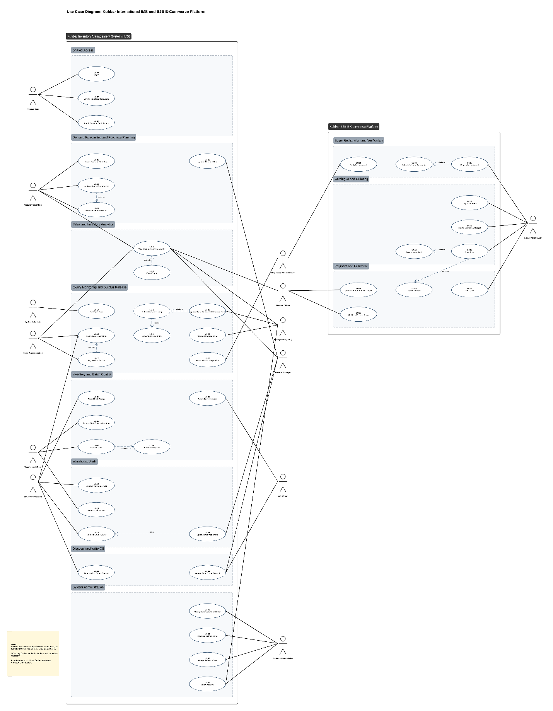
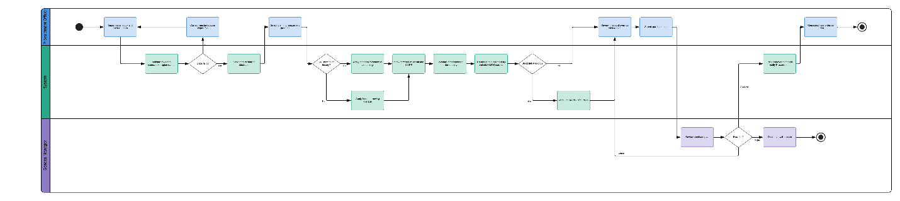
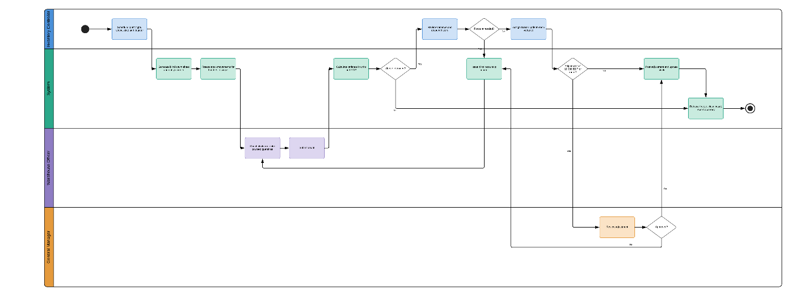
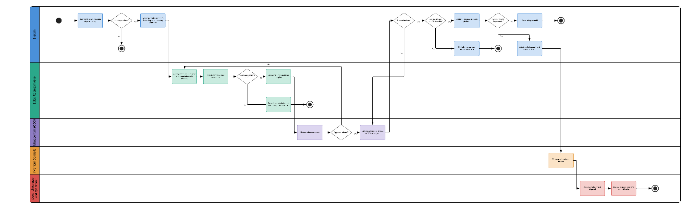
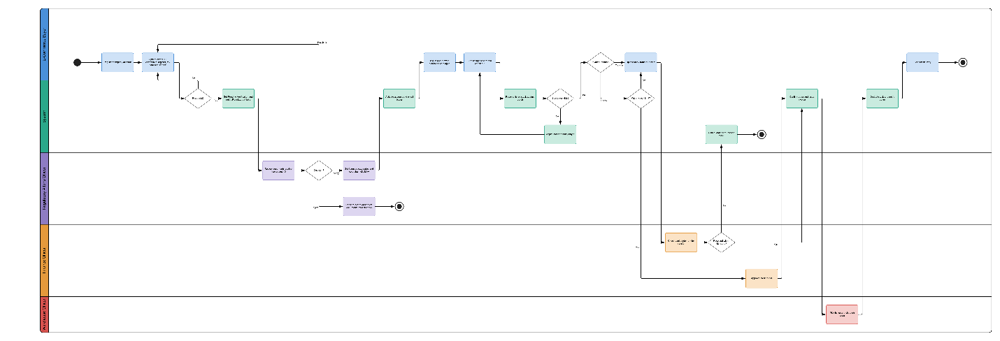
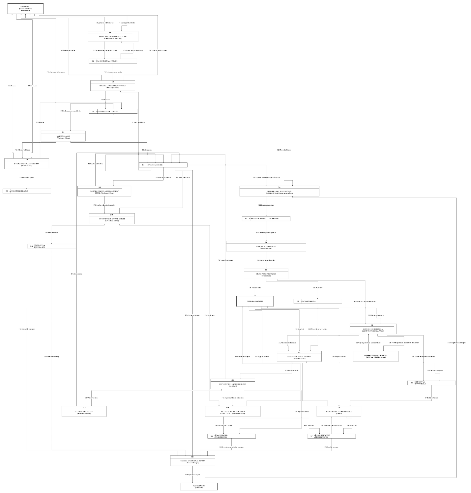
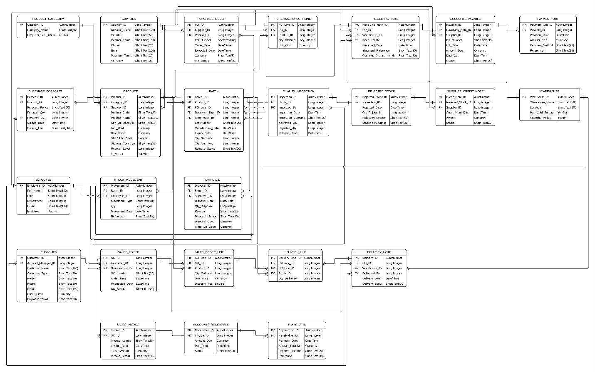

Software Requirements

Draft

Student Name: Mostafa Ammar Abdelazim

Student ID: 900203676

Section: 3

Course: MOIS 4999 - Graduation Project

Delivered to: Dr. Dina Rateb \| Dr. Aida Zakaria \| Dr. Kamal Boutros

Date: Fall 2026

# Table of Contents

[1. Solution Objective [3](#section)](#section)

[2. Solution Overview [4](#solution-overview)](#solution-overview)

[3. Abbreviations and Definitions
[6](#abbreviations-and-definitions)](#abbreviations-and-definitions)

[4. User Profiles [8](#user-profiles)](#user-profiles)

[5. Solution Scope [12](#solution-scope)](#solution-scope)

[5.1 In Scope [12](#in-scope)](#in-scope)

[5.2 Out of Scope [14](#out-of-scope)](#out-of-scope)

[5.3 Release Phasing [15](#release-phasing)](#release-phasing)

[5.4 Assumptions [15](#assumptions)](#assumptions)

[5.5 Dependencies [16](#dependencies)](#dependencies)

[5.6 Constraints [16](#constraints)](#constraints)

[6. Functional Requirements
[16](#functional-requirements)](#functional-requirements)

[6.1 Authentication and Access Control
[17](#authentication-and-access-control)](#authentication-and-access-control)

[6.2 Inventory and Batch Control
[18](#inventory-and-batch-control)](#inventory-and-batch-control)

[6.3 Warehouse Audit [20](#warehouse-audit)](#warehouse-audit)

[6.4 Expiry Monitoring and Surplus Release
[21](#expiry-monitoring-and-surplus-release)](#expiry-monitoring-and-surplus-release)

[6.5 Disposal and Write-Off
[23](#disposal-and-write-off)](#disposal-and-write-off)

[6.6 Demand Forecasting and Purchase Planning
[24](#demand-forecasting-and-purchase-planning)](#demand-forecasting-and-purchase-planning)

[6.7 Business Rules and System Administration
[26](#business-rules-and-system-administration)](#business-rules-and-system-administration)

[6.8 Sales and Inventory Analytics
[28](#sales-and-inventory-analytics)](#sales-and-inventory-analytics)

[6.9 Buyer Registration and Verification
[30](#buyer-registration-and-verification)](#buyer-registration-and-verification)

[6.10 Catalogue and Ordering
[32](#catalogue-and-ordering)](#catalogue-and-ordering)

[6.11 Payment and Fulfilment
[33](#payment-and-fulfilment)](#payment-and-fulfilment)

[6.12 Odoo Integration (Full Release)
[34](#odoo-integration-full-release)](#odoo-integration-full-release)

[7. Non-Functional Requirements
[34](#non-functional-requirements)](#non-functional-requirements)

[7.1 Functionality [35](#functionality)](#functionality)

[7.2 Usability [35](#usability)](#usability)

[7.3 Reliability [36](#reliability)](#reliability)

[7.4 Performance [36](#performance)](#performance)

[7.5 Supportability [37](#supportability)](#supportability)

[7.6 Security [37](#security)](#security)

[8. Use Case Diagram [38](#use-case-diagram)](#use-case-diagram)

[9. Use Cases [40](#use-cases)](#use-cases)

[9.1 Use Case Summary [40](#use-case-summary)](#use-case-summary)

[9.2 Textual Use Case Specifications
[44](#textual-use-case-specifications)](#textual-use-case-specifications)

[10. Activity Diagrams [80](#activity-diagrams)](#activity-diagrams)

[10.1 Demand Forecasting and Purchase Planning
[81](#demand-forecasting-and-purchase-planning-1)](#demand-forecasting-and-purchase-planning-1)

[10.2 Warehouse Audit [81](#warehouse-audit-1)](#warehouse-audit-1)

[10.3 Near-Expiry Products
[82](#near-expiry-products)](#near-expiry-products)

[10.4 E-Commerce Purchase
[83](#e-commerce-purchase)](#e-commerce-purchase)

[11. Data Models [84](#data-models)](#data-models)

[11.1 Data Flow Diagram [84](#data-flow-diagram)](#data-flow-diagram)

[11.2 Entity Relationship Diagram
[85](#entity-relationship-diagram)](#entity-relationship-diagram)

[12. Conclusion [90](#conclusion)](#conclusion)

# 

# 1. Solution Objective

The proposed solution gives Kubbar International a way to act on its
inventory before the loss becomes irreversible. The Root Cause Analysis
established that the company imports against supplier minimum order
quantities and long lead times, sells through a single field channel
into a finite customer base, and recognizes surplus only at expiry. The
company therefore pays three times for the same inventory error: once in
lost profit, once in holding cost, and once in regulated disposal. The
proposed solution intercepts stock between unsold and expired.

It does so through two web applications that share one database. The
Inventory Management System (IMS) is the internal application. It holds
every batch with its lot number, expiry date, location, and market
registration, audits that record against the physical warehouse,
forecasts demand from sales history before the company commits to a
purchase, and raises an alert once a batch enters its six-month action
window. The B2B E-Commerce Platform is the external application. It
offers released near-expiry batches at 65% to 70% of their original
price to verified trade buyers that the field sales team does not
currently reach.

The proposed solution is designed to achieve the following outcomes:

- One batch-level record of stock, showing how old each quantity is
  rather than only how much is held.

- A demand forecast and purchase plan built inside the system from
  actual sales by product, region, and customer, replacing the
  spreadsheet that currently sits outside Odoo.

- Warehouse audits that reconcile the system record with the physical
  count, so that alerts and listings rest on accurate data.

- An automatic near-expiry alert six months before expiry, with a named
  owner and a defined route: existing customers first, the clearance
  channel second, disposal last.

- Executive control over which batches are released and at what price,
  so that recovered value does not displace full-price sales.

- A second route to market for surplus stock, open to distributors,
  veterinary clinics, pharmacies, farms, feed mills, and other
  suppliers, each verified before purchase.

- Management analytics that link inventory to sales and report value at
  risk, recovered value, and forecast accuracy in EGP.

Surplus stock does not need better visibility of the same buyers. It
needs different buyers, and it needs to reach them while it still has
value. Every requirement in this document traces back to that objective.

# 2. Solution Overview

The proposed solution is two cloud-hosted web applications built on one
shared database. The DFD As-Is showed that Kubbar's transactional record
is complete but that nothing reads the expiry data in a way that could
act on it, and that no entity exists to receive surplus stock. The IMS
introduces the first missing element: the process that reads expiry
data. The E-Commerce Platform introduces the second: the buyer. Because
both applications read and write the same records, a batch offered
online is the same batch the warehouse holds, so stock that has already
been sold or has already expired cannot be offered.

The IMS is internal and is accessed only by Kubbar staff. The E-Commerce
Platform is public-facing, but only verified trade buyers can see prices
or place orders. The pilot runs in Egypt, so all prices are in EGP and
only products registered for sale in Egypt can be listed. The data model
holds a market for every buyer and every registration, so the same rules
extend to Kubbar's other eight markets without redesign.

In the full release, both applications connect to Kubbar's Odoo ERP
through its API. The IMS reads products, customers, sales orders, and
stock movements from Odoo and writes platform sales back to it, so that
Odoo remains the system of record for accounting. The prototype does not
connect to Odoo. It runs on sales, stock, and product data imported from
Odoo exports in Excel or CSV format, the same data used to build the
data warehouse.

The IMS is organized into seven modules:

**Module 1: Inventory and Batch Control.** The QA Officer records the
lot number, manufacture date, expiry date, and approved quantity of
every inspected batch. The Inventory Controller books approved batches
into a warehouse location. The Warehouse Officer transfers stock between
locations and dispatches orders, with the system allocating the
earliest-expiring batch first.

**Module 2: Warehouse Audit.** The Inventory Controller schedules full
or cycle counts. The Warehouse Officer records the physical count on a
blind count sheet. The system calculates the variance. The Inventory
Controller reconciles it, and the General Manager approves any
adjustment above the configured value threshold.

**Module 3: Expiry Monitoring and Surplus Release.** The system scans
every batch daily and raises an alert once a batch is six months or less
from expiry. The Sales Representative first checks whether existing
customers can absorb it. Batches they cannot absorb are flagged as
surplus. Management (the COO) approves release and sets a clearance
price within 65% to 70% of the original price. The system confirms
market registration and publishes the listing to the E-Commerce
Platform.

**Module 4: Disposal and Write-Off.** Batches that expire unsold, or
that fail inspection, are submitted for write-off by the Inventory
Controller and approved by the General Manager and the QA Officer. The
system records the write-off value and disposal cost, so that the loss
feeds back to procurement instead of ending as a finance entry.

**Module 5: Demand Forecasting and Purchase Planning.** The Procurement
Officer imports sales and stock data and generates a monthly demand
forecast by product and region. The system converts the forecast into a
recommended order quantity, rounds it up to the supplier minimum order
quantity, and shows the surplus that rounding creates before the order
is placed. The General Manager approves the purchase plan.

**Module 6: Sales and Inventory Analytics.** The system links inventory
to sales by product, region, and customer, and reports value at risk,
stock ageing, sell-through, days of cover, forecast accuracy, and
recovered value. Every report can be exported.

**Module 7: System Administration.** The System Administrator manages
user accounts and roles for both applications, configures business rules
such as the near-expiry window and the clearance price band, maintains
reference data, and reviews the audit trail.

The E-Commerce Platform is organized into three modules:

**Module 8: Buyer Registration and Verification.** A trade buyer
registers a company account and uploads the owner's national ID,
commercial register, tax card, and the licence that authorizes the
company to trade veterinary products. The Regulatory Affairs Officer
verifies the documents and sets which product categories the buyer may
purchase.

**Module 9: Catalogue and Ordering.** A verified buyer browses released
listings that show batch number, expiry date, remaining shelf life,
storage condition, quantity, and clearance price, then places an order.
The system reserves the listed quantity at checkout so that no batch can
be sold twice.

**Module 10: Payment and Fulfilment.** The buyer pays by bank transfer
or on invoice. The Finance Officer confirms the payment or the invoice
terms, the Warehouse Officer dispatches the order, and the buyer tracks
it to delivery.

At the data level, the shared database holds batch records (lot number,
manufacture and expiry dates, quantity, location, release status),
product registrations by market, sales history by product, region, and
customer, forecasts and purchase plans, audit counts and adjustments,
listings, buyers and their verification documents, platform orders and
payments, write-offs and disposals, and a complete audit trail of who
did what and when.

# 3. Abbreviations and Definitions

As shown in Exhibit \#1, the document uses a small set of abbreviations
and three operational terms that carry a precise meaning in this
specification. The three terms (near-expiry, surplus, and clearance
price) are defined here because each one triggers a different system
behavior.

| Term            | Definition                                                                                                                                      |
|-----------------|-------------------------------------------------------------------------------------------------------------------------------------------------|
| API             | Application Programming Interface, used in the full release to connect both applications to Odoo                                                |
| B2B             | Business-to-Business                                                                                                                            |
| Batch           | A quantity of one product sharing one lot number, manufacture date, and expiry date                                                             |
| Clearance Price | The price at which a released batch is listed on the E-Commerce Platform, set between 65% and 70% of the product's original sale price          |
| COO             | Chief Operating Officer, who approves batch release and clearance price on behalf of Management                                                 |
| DFD             | Data Flow Diagram                                                                                                                               |
| EDA             | Egyptian Drug Authority, which registers veterinary vaccines and medicaments in Egypt                                                           |
| EGP             | Egyptian Pound, the currency of the pilot                                                                                                       |
| ERD             | Entity Relationship Diagram                                                                                                                     |
| ERP             | Enterprise Resource Planning (Odoo, in Kubbar's case)                                                                                           |
| FEFO            | First-Expired-First-Out, the rule that allocates the batch with the earliest expiry date first                                                  |
| FR              | Functional Requirement                                                                                                                          |
| GOVS            | General Organization for Veterinary Services, which registers feed additives and nutritional products in Egypt with the Ministry of Agriculture |
| IMS             | Inventory Management System, the internal application of the proposed solution                                                                  |
| KPI             | Key Performance Indicator                                                                                                                       |
| MAPE            | Mean Absolute Percentage Error, the measure of forecast accuracy                                                                                |
| MOQ             | Minimum Order Quantity set by the supplier                                                                                                      |
| Near-Expiry     | A batch with six months (180 days) or less of remaining shelf life                                                                              |
| NFR             | Non-Functional Requirement                                                                                                                      |
| PDPL            | Egyptian Personal Data Protection Law No. 151 of 2020                                                                                           |
| QA              | Quality Assurance                                                                                                                               |
| RBAC            | Role-Based Access Control                                                                                                                       |
| SDLC            | Systems Development Life Cycle                                                                                                                  |
| SRS             | Software Requirements Specification                                                                                                             |
| Surplus         | A near-expiry batch that the Sales Representative confirms existing customers cannot absorb before expiry                                       |
| UAT             | User Acceptance Testing                                                                                                                         |
| UC              | Use Case                                                                                                                                        |
| Value at Risk   | The cost value, in EGP, of near-expiry stock not yet sold or released                                                                           |

*Exhibit \#1: Abbreviations and Definitions*

# 4. User Profiles

The proposed solution serves the same roles that perform Kubbar's
processes in the DFD As-Is, plus two roles that the current operation
does not have. Nine internal roles come directly from the DFD. Each
keeps the responsibility it holds today, so the system formalizes
existing work rather than redistributing it. The System Administrator is
added because two applications with role-based access need an owner. The
E-Commerce Buyer is added because, as the DFD showed, no entity in the
current operation can receive surplus stock.

Two DFD external entities are not system users. Overseas Partners and
Government Authorities exchange documents with Kubbar outside the
system, and their outputs (lot and expiry data, import permits, product
registrations) enter the IMS through the QA Officer and the Regulatory
Affairs Officer. Existing Customers continue to buy through the field
sales team, because the platform is directed at buyers the field team
does not reach rather than at accounts it already holds.

| User Role                        | Application      | Responsibilities                                                                                                                                                                                                         | Key Competencies                                           |
|----------------------------------|------------------|--------------------------------------------------------------------------------------------------------------------------------------------------------------------------------------------------------------------------|------------------------------------------------------------|
| Sales Representative             | IMS              | Reviews near-expiry batches for their products and regions. Offers them to existing customers first. Flags batches the customer base cannot absorb as surplus. Reviews sales analytics by product, region, and customer. | Customer knowledge, product knowledge, sales analysis      |
| Warehouse Officer                | IMS              | Transfers stock between locations. Picks and dispatches platform orders against FEFO allocation. Records physical counts during warehouse audits.                                                                        | Stock handling, cold-chain handling, counting accuracy     |
| Inventory Controller             | IMS              | Books inspected batches into stock. Schedules warehouse audits and reconciles count variances. Reviews near-expiry stock. Requests write-off of expired or rejected batches.                                             | Inventory control, reconciliation, data accuracy           |
| QA Officer                       | IMS              | Records lot number, manufacture date, expiry date, and inspection outcome for every received batch. Co-approves write-off and disposal of expired and rejected stock.                                                    | Quality inspection, batch traceability, regulated disposal |
| Procurement Officer              | IMS              | Imports sales and stock data. Generates the demand forecast. Builds the purchase plan against supplier MOQs and submits it for approval. Reviews forecast accuracy.                                                      | Demand planning, supplier terms, data analysis             |
| Regulatory Affairs Officer       | IMS              | Maintains product registration status and expiry by market. Verifies buyer documents and sets the product categories each buyer may purchase.                                                                            | EDA and GOVS registration, licence verification            |
| Finance Officer                  | IMS              | Confirms bank transfer payments. Approves invoice payment terms and credit limits for buyers. Issues platform invoices. Exports financial reports.                                                                       | Receivables, credit control, invoicing                     |
| General Manager                  | IMS              | Approves the purchase plan. Approves stock adjustments above threshold. Co-approves write-off and disposal. Reviews analytics for the Egyptian operation.                                                                | Operational oversight, approval authority                  |
| Management (CEO, Group CFO, COO) | IMS              | The COO approves batch release, sets the clearance price within the 65% to 70% band, and withdraws or reprices listings. Management reviews KPIs, recovered value, and the audit trail.                                  | Commercial authority, pricing control, performance review  |
| System Administrator             | IMS and Platform | Creates, edits, and deactivates internal user accounts and roles. Configures business rules. Maintains reference data. Reviews the audit trail.                                                                          | Access control, configuration, system support              |
| E-Commerce Buyer                 | Platform         | Registers a company account and uploads verification documents. Browses clearance listings, places orders, submits payment, and tracks delivery.                                                                         | Trade purchasing, licensed to trade veterinary products    |

*Exhibit \#2: User Profiles*

As shown in Exhibit \#2, approval authority stays where the DFD and the
Top Management Feasibility assessment place it. The General Manager
approves the purchase plan and disposal, as in processes 6.0 and 15.0 of
the DFD. The COO controls which batches are released and at what price,
as the proposal assigns. The sales team enters the clearance channel
through the batch-flagging role, as the Operational Feasibility
assessment requires, so the channel is entered through the team rather
than around it.

# 5. Solution Scope

The scope covers the full life of a batch, from the forecast that
decides whether to buy it to the sale or disposal that ends it. It is
deliberately limited to that life. The proposed solution does not
replace Odoo, does not handle accounting, and does not change how the
field sales team serves existing accounts. Its job is the part of the
cycle that no current system performs.

## 5.1 In Scope

In-scope functions are grouped by module and traced to the roles in
Section 4.

**Inventory and Batch Control (Module 1)**

- Batch inspection records with lot number, manufacture date, expiry
  date, storage condition, approved quantity, and rejected quantity (QA
  Officer).

- Stock receipt of approved batches into a warehouse and bin location
  (Inventory Controller).

- Stock transfer between locations and dispatch of platform orders with
  FEFO allocation (Warehouse Officer).

- Search of stock and batch records by product, category, lot,
  warehouse, expiry range, and release status (all internal roles).

**Warehouse Audit (Module 2)**

- Scheduling of full counts and cycle counts by warehouse, category, or
  batch (Inventory Controller).

- Blind physical count entry, with the system quantity hidden from the
  counter (Warehouse Officer).

- Variance calculation, reconciliation with a reason code, and
  adjustment posting, with General Manager approval above the configured
  threshold.

**Expiry Monitoring and Surplus Release (Module 3)**

- A daily expiry scan with alerts at six months, and at the minimum
  sellable shelf life (default 30 days).

- Review of near-expiry stock, an offer to existing customers, and
  surplus flagging (Sales Representative).

- Batch release approval and clearance price setting within 65% to 70%
  of the original price (COO).

- Market registration checks before any listing is published, and
  registration maintenance (Regulatory Affairs Officer).

**Disposal and Write-Off (Module 4)**

- Write-off requests for expired, damaged, or rejected batches, with
  dual approval by the General Manager and the QA Officer.

- Recording of disposal method, disposal cost, write-off value, and the
  disposal certificate reference.

**Demand Forecasting and Purchase Planning (Module 5)**

- Import of sales history, stock, and product data from Odoo exports in
  the prototype.

- A monthly demand forecast by product and region using seasonal
  exponential smoothing, with a moving-average fallback for products
  with short history.

- Recommended order quantity net of stock on hand, open purchase orders,
  and stock that expires within the coverage period, rounded up to the
  supplier MOQ, with the resulting MOQ surplus shown in units and EGP.

- Purchase plan submission and General Manager approval.

**Sales and Inventory Analytics (Module 6)**

- KPI dashboards and reports covering value at risk, stock ageing, days
  to expiry, days of cover, sell-through by product, region, and
  customer, forecast accuracy, recovered value, write-off cost, audit
  accuracy, and buyer activity.

- Export of reports in PDF and Excel format.

**System Administration (Module 7)**

- User accounts and roles, business rule configuration, reference data
  maintenance, and the audit trail.

**Buyer Registration and Verification (Module 8)**

- Company registration with the owner's national ID, commercial
  register, tax card, and the licence that authorizes trading in
  veterinary products.

- Document verification and category eligibility set by the Regulatory
  Affairs Officer.

**Catalogue and Ordering (Module 9)**

- A catalogue of released listings filtered by the buyer's market and
  licensed categories.

- Cart, checkout, and stock reservation at the moment of checkout.

**Payment and Fulfilment (Module 10)**

- Payment by bank transfer (with upload of the transfer receipt) or on
  invoice for buyers approved for credit.

- Payment confirmation, invoice issue, dispatch, and order tracking.

## 5.2 Out of Scope

Explicit exclusions protect the 12-week schedule and keep the system
from drifting into functions that Odoo already performs.

- **ERP and Financial Functions.** General ledger, accounts payable,
  payroll, and tax filing remain in Odoo. The proposed solution issues
  platform invoices and records payments, then hands them to Odoo in the
  full release.

- **Field Sales and CRM.** Quotations, customer visits, and orders from
  existing accounts remain in the Odoo CRM and Sales modules.

- **Card and Online Payments.** No payment gateway, card payment, or
  wallet is in scope. Payment is by bank transfer or on invoice only.

- **Consumer Sales.** The platform does not sell to individuals or end
  consumers.

- **Logistics.** Carrier booking, route planning, and fleet management
  are excluded. The Warehouse Officer records dispatch and delivery.

- **Machine Learning.** Forecasting uses established statistical
  methods. Machine learning models and automated purchase order creation
  are excluded.

- **Markets Other Than Egypt.** The data model supports nine markets,
  but only Egypt is activated in the pilot. Each further market requires
  its own legal review, as the Legal Feasibility assessment states.

- **Non-Expiring Products.** Capital equipment does not expire, so it is
  excluded from expiry monitoring and clearance listings. It remains
  visible in stock ageing reports.

- **Hardware.** Barcode scanners, RFID, and temperature sensors are
  excluded from the current phase.

## 5.3 Release Phasing

The proposed solution is delivered in two releases. The prototype proves
the logic on real Kubbar data without touching live systems. The full
release connects it to Odoo.

| Capability                          | Prototype                              | Full Release                                    |
|-------------------------------------|----------------------------------------|-------------------------------------------------|
| IMS Modules 1 to 7                  | Yes                                    | Yes                                             |
| E-Commerce Platform Modules 8 to 10 | Yes                                    | Yes                                             |
| Data source                         | Excel and CSV import from Odoo exports | Scheduled API synchronization with Odoo         |
| Sales written back to Odoo          | No                                     | Yes                                             |
| Markets active                      | Egypt                                  | Egypt, then the other eight markets in sequence |
| Notifications                       | In-app and email                       | In-app and email                                |

*Exhibit \#3: Release Phasing*

### 5.4 Assumptions

- Kubbar can export at least 24 months of sales history by product,
  region, customer, quantity, and price. The data warehouse draft
  already holds 2024 to 2026 sales for Egypt.

- Lot number and expiry date are available for every batch in stock at
  go-live, either from Odoo or from the QA inspection records.

- Each product has a recorded original sale price, which is the base for
  the clearance price band.

- Product registration status for Egypt can be confirmed by the
  Regulatory Affairs Officer before go-live.

- The COO, or a delegate the COO names, is available to approve releases
  within two working days of a surplus flag.

- Trade buyers in Egypt can provide the owner's national ID, commercial
  register, tax card, and trading licence in digital form.

### 5.5 Dependencies

- Requirements must be formally approved before design begins,
  consistent with the Waterfall sequence.

- The IMS must be built and populated before the E-Commerce Platform,
  because the platform has nothing accurate to display until batch,
  expiry, and registration data exist. The Technical Feasibility
  assessment identified this build order.

- The business rules in Section 6.7 (near-expiry window, price band,
  variance threshold, minimum sellable shelf life) must be signed off by
  Management before UAT.

- The DFD and ERD must be extended to include the platform entities
  listed in Section 11.

- The full release depends on API access to Kubbar's Odoo instance.

### 5.6 Constraints

- Only products registered in the buyer's market and within the minimum
  sellable shelf life may be listed or sold.

- Buyer personal data must be collected with consent and stored securely
  under the PDPL.

- The clearance price cannot fall outside 65% to 70% of the original
  price without a change to the business rule by the System
  Administrator, approved by Management.

- Cold-chain products can only be sold to buyers whose verification
  confirms cold storage.

- The system must be usable by staff without technical training beyond a
  short orientation.

- The project follows a 12-week Waterfall lifecycle from 8 September to
  2 December 2026.

# 6. Functional Requirements

The functional requirements below are organized by module and trace to
the forty-four use cases in Section 9. Each requirement states what the
system shall do, not how it is built. The requirements that carry the
most weight are the ones the Root Cause Analysis points to directly:
batch-level expiry data (FR-07 to FR-12), the six-month alert and
release route (FR-24 to FR-34), and the forecast that exposes MOQ
surplus before purchase (FR-41 to FR-49).

## 6.1 Authentication and Access Control

| ID    | Requirement                                                                                                                                                               | Use Case     |
|-------|---------------------------------------------------------------------------------------------------------------------------------------------------------------------------|--------------|
| FR-01 | The system shall allow internal users to log in to the IMS with a registered email address and password.                                                                  | UC-01        |
| FR-02 | The system shall allow verified buyers to log in to the E-Commerce Platform with a registered email address and password, separately from internal accounts.              | UC-32        |
| FR-03 | The system shall restrict every screen, action, and record to the roles assigned to it, as defined in Exhibit \#2.                                                        | All          |
| FR-04 | The system shall lock an account after five consecutive failed login attempts and notify the System Administrator (IMS) or allow self-service unlock by email (Platform). | UC-01, UC-32 |
| FR-05 | The system shall end a session on log out and clear all session data.                                                                                                     | UC-02        |
| FR-06 | The system shall display a role-specific dashboard with open alerts and pending approvals after login.                                                                    | UC-03        |

## 6.2 Inventory and Batch Control

| ID    | Requirement                                                                                                                                                                                                                         | Use Case                          |
|-------|-------------------------------------------------------------------------------------------------------------------------------------------------------------------------------------------------------------------------------------|-----------------------------------|
| FR-07 | The system shall allow the QA Officer to record, for each received batch, the product, lot number, manufacture date, expiry date, storage condition, quantity received, quantity approved, quantity rejected, and rejection reason. | UC-04                             |
| FR-08 | The system shall reject an inspection record whose expiry date is earlier than the manufacture date or earlier than the inspection date.                                                                                            | UC-04                             |
| FR-09 | The system shall calculate remaining shelf life at receipt and warn the QA Officer when it is below the configured minimum receiving shelf life (default 12 months).                                                                | UC-04                             |
| FR-10 | The system shall allow the Inventory Controller to book an approved batch into a warehouse and bin location, and shall update stock on hand only after booking.                                                                     | UC-05                             |
| FR-11 | The system shall prevent cold-chain products from being booked into a location without cold storage.                                                                                                                                | UC-05, UC-07                      |
| FR-12 | The system shall hold stock at batch level, so that two batches of the same product are never merged into one total.                                                                                                                | UC-05                             |
| FR-13 | The system shall allow the Warehouse Officer to transfer a batch quantity between locations, recording source, destination, quantity, user, and time.                                                                               | UC-07                             |
| FR-14 | The system shall allocate stock to a dispatch by FEFO, selecting the batch with the earliest expiry date that is still within the minimum sellable shelf life.                                                                      | UC-08, UC-09                      |
| FR-15 | The system shall deduct the dispatched quantity from the allocated batch on dispatch confirmation and prevent dispatch of more than the quantity on hand.                                                                           | UC-08                             |
| FR-16 | The system shall allow internal users to search stock and batch records by product, category, lot number, warehouse, expiry date range, days to expiry, and release status.                                                         | UC-06                             |
| FR-17 | The system shall record every stock movement (receipt, transfer, dispatch, adjustment, write-off) with batch, quantity, type, user, and timestamp.                                                                                  | UC-05, UC-07, UC-08, UC-12, UC-22 |

## 6.3 Warehouse Audit

| ID    | Requirement                                                                                                                                                                                      | Use Case     |
|-------|--------------------------------------------------------------------------------------------------------------------------------------------------------------------------------------------------|--------------|
| FR-18 | The system shall allow the Inventory Controller to schedule a full count or a cycle count by warehouse, category, or batch, and assign it to a Warehouse Officer.                                | UC-10        |
| FR-19 | The system shall freeze stock movements for the batches under count from the start of the count until it is submitted.                                                                           | UC-10, UC-11 |
| FR-20 | The system shall present a blind count sheet that shows product, lot, and location but hides the system quantity.                                                                                | UC-11        |
| FR-21 | The system shall calculate the variance per batch in units and in EGP at cost once the count is submitted, and flag variances above the configured tolerance.                                    | UC-11, UC-12 |
| FR-22 | The system shall require the Inventory Controller to assign a reason code (counting error, damage, loss, expiry not recorded, mis-location) to every flagged variance, with an optional recount. | UC-12        |
| FR-23 | The system shall post adjustments below the approval threshold directly and route adjustments above it to the General Manager, updating stock only after approval.                               | UC-12, UC-13 |

## 6.4 Expiry Monitoring and Surplus Release

| ID    | Requirement                                                                                                                                                                                                                      | Use Case     |
|-------|----------------------------------------------------------------------------------------------------------------------------------------------------------------------------------------------------------------------------------|--------------|
| FR-24 | The system shall scan every batch with stock on hand once a day and calculate days to expiry.                                                                                                                                    | UC-14        |
| FR-25 | The system shall mark a batch as Near-Expiry when it has 180 days or less to expiry and notify the Inventory Controller and the Sales Representative responsible for its product and region.                                     | UC-14        |
| FR-26 | The system shall escalate to the General Manager any Near-Expiry batch that has had no action (offered, flagged, or released) for 14 days.                                                                                       | UC-14        |
| FR-27 | The system shall allow the Sales Representative to record that a Near-Expiry batch has been offered to an existing customer, with the customer, quantity, and outcome.                                                           | UC-15        |
| FR-28 | The system shall show, for each Near-Expiry batch, the average monthly sales of that product over the last 12 months and the projected quantity left unsold at expiry.                                                           | UC-15        |
| FR-29 | The system shall allow the Sales Representative to flag all or part of a Near-Expiry batch as Surplus with a reason, and route it to Management for release.                                                                     | UC-16        |
| FR-30 | The system shall allow the COO to approve or reject the release of a surplus batch, the released quantity, and a clearance price.                                                                                                | UC-17        |
| FR-31 | The system shall propose a clearance price of 70% of the original sale price and reject any clearance price below 65% or above 70% of it.                                                                                        | UC-17, UC-40 |
| FR-32 | The system shall check, before publishing a listing, that the product is registered and its registration valid in the listing market, and block the listing if not.                                                              | UC-18, UC-19 |
| FR-33 | The system shall publish an approved release as a listing on the E-Commerce Platform showing product, category, lot number, expiry date, remaining shelf life, storage condition, available quantity, unit, and clearance price. | UC-18        |
| FR-34 | The system shall withdraw a listing automatically when remaining shelf life reaches the minimum sellable shelf life (default 30 days) or when the registration lapses.                                                           | UC-14, UC-18 |
| FR-35 | The system shall allow the Regulatory Affairs Officer to record and update, per product and market, the registering authority (EDA or GOVS), registration number, status, and registration expiry date.                          | UC-20        |

## 6.5 Disposal and Write-Off

| ID    | Requirement                                                                                                                                          | Use Case     |
|-------|------------------------------------------------------------------------------------------------------------------------------------------------------|--------------|
| FR-36 | The system shall allow the Inventory Controller to request write-off of an expired, damaged, or rejected batch, with quantity and reason.            | UC-21        |
| FR-37 | The system shall prevent any further sale, allocation, or listing of a batch that has passed its expiry date.                                        | UC-14, UC-21 |
| FR-38 | The system shall require approval by both the General Manager and the QA Officer before a write-off is posted.                                       | UC-22        |
| FR-39 | The system shall record disposal method, disposal date, disposal cost in EGP, write-off value at cost, and disposal certificate reference.           | UC-22        |
| FR-40 | The system shall link every write-off to the purchase plan period that bought the batch, so that the loss is visible in forecast accuracy reporting. | UC-22, UC-27 |

## 6.6 Demand Forecasting and Purchase Planning

| ID    | Requirement                                                                                                                                                                                                                        | Use Case |
|-------|------------------------------------------------------------------------------------------------------------------------------------------------------------------------------------------------------------------------------------|----------|
| FR-41 | The system shall allow the Procurement Officer to import sales history, stock on hand, open purchase orders, and product data from Excel or CSV files exported from Odoo.                                                          | UC-23    |
| FR-42 | The system shall validate imported files, reject rows with missing product, date, or quantity, and standardize region names to the reference list (for example, "Cairo & Giza" and "Cairo&Giza" to one region).                    | UC-23    |
| FR-43 | The system shall generate a monthly demand forecast by product and region for a planning horizon of up to 12 months, using seasonal exponential smoothing where 24 months of history exist and a 6-month moving average otherwise. | UC-24    |
| FR-44 | The system shall display each forecast with its prior-period accuracy (MAPE) and the actual sales it is compared against.                                                                                                          | UC-24    |
| FR-45 | The system shall calculate a recommended order quantity as forecast demand over the supplier lead time and coverage period, plus safety stock, minus usable stock on hand, minus open purchase orders.                             | UC-25    |
| FR-46 | The system shall exclude from usable stock any quantity projected to reach Near-Expiry before it can be sold at the forecast rate.                                                                                                 | UC-25    |
| FR-47 | The system shall round the recommended quantity up to the supplier MOQ and show the MOQ surplus in units, in EGP, and as the projected quantity left at expiry.                                                                    | UC-25    |
| FR-48 | The system shall allow the Procurement Officer to override a recommended quantity with a mandatory reason and submit the purchase plan for approval.                                                                               | UC-25    |
| FR-49 | The system shall allow the General Manager to approve, return, or reject a purchase plan line by line with comments, and lock approved plans.                                                                                      | UC-26    |

## 6.7 Business Rules and System Administration

The business rules below are configurable by the System Administrator,
and any change requires Management approval. Their default values follow
the decisions recorded in the proposal and in this specification.

| Rule                                 | Default Value                     |
|--------------------------------------|-----------------------------------|
| Near-expiry window                   | 180 days (6 months)               |
| Clearance price band                 | 65% to 70% of original sale price |
| Minimum sellable shelf life          | 30 days                           |
| Minimum receiving shelf life warning | 12 months                         |
| Unactioned near-expiry escalation    | 14 days                           |
| Count variance tolerance             | 2% of batch quantity              |
| Adjustment approval threshold        | 10,000 EGP at cost                |
| Platform order reservation hold      | 48 hours for bank transfer orders |
| Active market                        | Egypt                             |

*Exhibit \#4: Business Rules and Default Values*

| ID    | Requirement                                                                                                                                                                                                     | Use Case |
|-------|-----------------------------------------------------------------------------------------------------------------------------------------------------------------------------------------------------------------|----------|
| FR-50 | The system shall allow the System Administrator to create, edit, and deactivate internal user accounts and assign one or more roles.                                                                            | UC-41    |
| FR-51 | The system shall allow the System Administrator to suspend or reactivate buyer accounts.                                                                                                                        | UC-41    |
| FR-52 | The system shall allow the System Administrator to configure the business rules in Exhibit \#4 and record the approving manager for each change.                                                                | UC-42    |
| FR-53 | The system shall allow the System Administrator to maintain reference data: warehouses and locations, product categories, regions, markets, suppliers, reason codes, and buyer types.                           | UC-43    |
| FR-54 | The system shall keep a tamper-proof audit trail of logins, approvals, price changes, adjustments, write-offs, verification decisions, and configuration changes, searchable by user, action, record, and date. | UC-44    |

## 6.8 Sales and Inventory Analytics

| ID    | Requirement                                                                                                                                                                        | Use Case |
|-------|------------------------------------------------------------------------------------------------------------------------------------------------------------------------------------|----------|
| FR-55 | The system shall display value at risk in EGP, by category, product, and warehouse.                                                                                                | UC-27    |
| FR-56 | The system shall display stock ageing by remaining shelf life in four bands (more than 12 months, 6 to 12 months, 30 days to 6 months, under 30 days) with quantity and EGP value. | UC-27    |
| FR-57 | The system shall display sales by product, region, customer, and month, including sell-through rate and each region's share of a product's sales.                                  | UC-27    |
| FR-58 | The system shall display days of cover and inventory turnover per product.                                                                                                         | UC-27    |
| FR-59 | The system shall display forecast versus actual sales and MAPE by product and region.                                                                                              | UC-27    |
| FR-60 | The system shall display recovered value: quantity and value released, sold through the platform, recovery rate against original value, and average days from listing to sale.     | UC-27    |
| FR-61 | The system shall display write-off value, disposal cost, and the number of batches expired per month.                                                                              | UC-27    |
| FR-62 | The system shall display audit accuracy (share of counted batches within tolerance) and adjustment value per audit.                                                                | UC-27    |
| FR-63 | The system shall display platform activity: verified buyers, new buyers per month, orders, average order value, and sales by buyer type.                                           | UC-27    |
| FR-64 | The system shall allow authorized users to filter analytics by date range, category, product, region, and warehouse.                                                               | UC-27    |
| FR-65 | The system shall allow authorized users to export any report or dashboard in PDF or Excel format, stamped with filters, user, and time.                                            | UC-28    |

## 6.9 Buyer Registration and Verification

| ID    | Requirement                                                                                                                                                                                                          | Use Case     |
|-------|----------------------------------------------------------------------------------------------------------------------------------------------------------------------------------------------------------------------|--------------|
| FR-66 | The system shall allow a buyer to register a company account with company name, buyer type (distributor, veterinary clinic, pharmacy, farm, feed mill, supplier), market, address, contact person, email, and phone. | UC-29        |
| FR-67 | The system shall require upload of the owner's national ID, commercial register, tax card, and license to trade veterinary products, and shall accept cold storage proof as an optional document.                    | UC-29, UC-30 |
| FR-68 | The system shall accept PDF, JPG, and PNG files up to 10 MB each and store them encrypted.                                                                                                                           | UC-30        |
| FR-69 | The system shall record the buyer's consent to data processing and terms of service at registration.                                                                                                                 | UC-29        |
| FR-70 | The system shall flag any registration whose commercial register number matches an existing Kubbar customer and route it to that customer's Sales Representative.                                                    | UC-29, UC-31 |
| FR-71 | The system shall allow the Regulatory Affairs Officer to approve, reject, or request resubmission of each document, and approve the account only when all mandatory documents are approved.                          | UC-31        |
| FR-72 | The system shall allow the Regulatory Affairs Officer to set the product categories a buyer may purchase, and whether the buyer may purchase cold-chain products.                                                    | UC-31        |
| FR-73 | The system shall notify the buyer by email of each verification decision and the reason for any rejection.                                                                                                           | UC-31        |
| FR-74 | The system shall alert the Regulatory Affairs Officer 30 days before any buyer licence expires, and suspend ordering when it does.                                                                                   | UC-31        |

## 6.10 Catalogue and Ordering

| ID    | Requirement                                                                                                                                                        | Use Case     |
|-------|--------------------------------------------------------------------------------------------------------------------------------------------------------------------|--------------|
| FR-75 | The system shall show prices and allow ordering only to verified buyers, and shall show each buyer only listings in their market and licensed categories.          | UC-33        |
| FR-76 | The system shall allow buyers to search and filter listings by category, product, expiry date, remaining shelf life, and price.                                    | UC-33        |
| FR-77 | The system shall allow a buyer to add listings to a cart, with quantities limited to the available listed quantity.                                                | UC-34        |
| FR-78 | The system shall reserve the ordered quantity against the listed batch at checkout and release it if the order is cancelled or unpaid within the reservation hold. | UC-34, UC-35 |
| FR-79 | The system shall require the buyer to confirm cold-chain receiving capability before ordering cold-chain products.                                                 | UC-34        |
| FR-80 | The system shall allow the COO to withdraw a listing or change its price within the price band, without affecting confirmed orders.                                | UC-40        |

## 6.11 Payment and Fulfilment

| ID    | Requirement                                                                                                                                                      | Use Case     |
|-------|------------------------------------------------------------------------------------------------------------------------------------------------------------------|--------------|
| FR-81 | The system shall offer bank transfer to all verified buyers and payment on invoice only to buyers the Finance Officer has approved for credit.                   | UC-36, UC-39 |
| FR-82 | The system shall display Kubbar's bank details and order reference for bank transfer and allow the buyer to upload the transfer receipt.                         | UC-36        |
| FR-83 | The system shall allow the Finance Officer to confirm or reject a bank transfer and to set a buyer's payment terms (15, 30, or 45 days) and credit limit in EGP. | UC-38, UC-39 |
| FR-84 | The system shall block an on-invoice order that would take the buyer above their credit limit or that is placed while the buyer has an overdue invoice.          | UC-36, UC-39 |
| FR-85 | The system shall release a confirmed order to the warehouse for dispatch and generate an invoice in EGP.                                                         | UC-38        |
| FR-86 | The system shall update order status (Placed, Awaiting Payment, Confirmed, Dispatched, Delivered, Cancelled) and notify the buyer at each change.                | UC-37        |

## 6.12 Odoo Integration (Full Release)

The requirements below apply to the full release only. The prototype
meets the same data needs through FR-41.

| ID    | Requirement                                                                                                                                  | Use Case |
|-------|----------------------------------------------------------------------------------------------------------------------------------------------|----------|
| FR-87 | The system shall read products, customers, sales orders, purchase orders, and stock movements from Odoo through its API at least once a day. | UC-23    |
| FR-88 | The system shall write confirmed platform sales and invoices back to Odoo so that Odoo remains the accounting record.                        | UC-38    |
| FR-89 | The system shall log every synchronization with record counts and errors, and alert the System Administrator when a run fails.               | UC-44    |

# 7. Non-Functional Requirements

The non-functional requirements are set for Kubbar's scale and risk
profile, and each one carries a measurable target. They are organized
under the FURPS framework, with Security as an additional category. The
Risk Assessment found that the highest risks cluster around data
integrity rather than technology, so the reliability and security
requirements carry the most weight here.

## 7.1 Functionality

| ID     | Requirement                                                                                                                                             |
|--------|---------------------------------------------------------------------------------------------------------------------------------------------------------|
| NFR-01 | Both applications shall read and write one shared database, so that stock on hand, reservations, and listings never disagree.                           |
| NFR-02 | The IMS and the E-Commerce Platform shall be separate web applications with separate login, so that a buyer account can never reach an internal screen. |
| NFR-03 | All monetary values in the pilot shall be stored and displayed in EGP with two decimal places.                                                          |

## 7.2 Usability

| ID     | Requirement                                                                                                                                                                                                 |
|--------|-------------------------------------------------------------------------------------------------------------------------------------------------------------------------------------------------------------|
| NFR-04 | The E-Commerce Platform shall be available in Arabic and English, with right-to-left layout for Arabic. The IMS shall be available in English, with Arabic customer and region names displayed as recorded. |
| NFR-05 | Fields drawn from fixed lists (warehouse, category, region, reason code, buyer type, status) shall be dropdowns, not free text.                                                                             |
| NFR-06 | Every alert shall link directly to the batch or record that raised it.                                                                                                                                      |
| NFR-07 | A new internal user shall be able to complete their core tasks after a 2-hour orientation. A new buyer shall be able to register without assistance in under 15 minutes.                                    |
| NFR-08 | The E-Commerce Platform shall be fully usable on a mobile phone screen of 360 pixels width.                                                                                                                 |

## 7.3 Reliability

| ID     | Requirement                                                                                                                                           |
|--------|-------------------------------------------------------------------------------------------------------------------------------------------------------|
| NFR-09 | The system shall reject any transaction that would produce a negative batch quantity, and no batch shall ever be reserved, sold, or dispatched twice. |
| NFR-10 | Reservation at checkout shall be atomic: when two buyers order the last units of a listing at the same time, exactly one order succeeds.              |
| NFR-11 | The daily expiry scan shall complete before 07:00 Cairo time, and a failed scan shall be retried and reported to the System Administrator.            |
| NFR-12 | No transaction record shall be deleted. Corrections shall be made by reversing entries that keep the original.                                        |
| NFR-13 | Imported data shall pass validation before it is written, and a failed import shall leave existing data unchanged.                                    |

## 7.4 Performance

| ID     | Requirement                                                                                                                                                |
|--------|------------------------------------------------------------------------------------------------------------------------------------------------------------|
| NFR-14 | Screens shall load within 3 seconds, and saves shall complete within 2 seconds, with up to 25 concurrent internal users and 200 concurrent buyer sessions. |
| NFR-15 | Analytics dashboards shall load within 5 seconds for 36 months of sales history.                                                                           |
| NFR-16 | A demand forecast for all active products and regions shall complete within 5 minutes.                                                                     |
| NFR-17 | A released listing shall appear in the catalogue within 1 minute of approval.                                                                              |

## 7.5 Supportability

| ID     | Requirement                                                                                                                                                                                                 |
|--------|-------------------------------------------------------------------------------------------------------------------------------------------------------------------------------------------------------------|
| NFR-18 | The IMS shall be available 99% of the time during Kubbar Egypt working hours (Sunday to Thursday, 08:00 to 18:00 Cairo time). The E-Commerce Platform shall be available 99.5% of the time, 24 hours a day. |
| NFR-19 | The database shall be backed up daily and kept for 30 days, with recovery within 4 hours and no more than 24 hours of data lost.                                                                            |
| NFR-20 | Business rules, reference data, and user roles shall be changed through administration screens, without code changes.                                                                                       |
| NFR-21 | The data model shall support activating a new market by adding reference data, registrations, and buyers, without changes to the schema.                                                                    |

## 7.6 Security

| ID     | Requirement                                                                                                                                                                             |
|--------|-----------------------------------------------------------------------------------------------------------------------------------------------------------------------------------------|
| NFR-22 | All traffic shall use HTTPS (TLS 1.2 or higher). Passwords shall be stored hashed and salted.                                                                                           |
| NFR-23 | Passwords shall be at least 10 characters, mixing letters and numbers. Internal users shall use two-factor authentication.                                                              |
| NFR-24 | Internal sessions shall time out after 15 minutes of inactivity, and buyer sessions after 30 minutes.                                                                                   |
| NFR-25 | Buyer identity and company documents shall be encrypted at rest, visible only to the Regulatory Affairs Officer and the System Administrator, and every view shall be logged.           |
| NFR-26 | Buyer data processing shall comply with the PDPL: consent recorded at registration, a stated purpose, and deletion of documents for rejected applications after 90 days.                |
| NFR-27 | Approvals, price changes, verification decisions, adjustments, and write-offs shall be logged with user, time, old value, and new value, and the log shall not be editable by any role. |

# 8. Use Case Diagram

Exhibit \#5 presents the use case diagram for the proposed solution. It
shows forty-three of the forty-four use cases across two system
boundaries. The IMS boundary holds eight zones, arranged as horizontal
bands: Shared Access, Demand Forecasting and Purchase Planning, Sales
and Inventory Analytics, Expiry Monitoring and Surplus Release,
Inventory and Batch Control, Warehouse Audit, Disposal and Write-Off,
and System Administration. The E-Commerce Platform boundary holds three:
Buyer Registration and Verification, Catalogue and Ordering, and Payment
and Fulfilment. The eleven roles from Exhibit \#2 sit outside the
boundaries. Two further actors complete the diagram. The System
Scheduler runs the daily expiry scan, and Internal User stands for any
of the ten internal roles, which keeps UC-01, UC-03, and UC-06 from
carrying ten association lines each.

*Exhibit \#5: Use Case Diagram - IMS and B2B E-Commerce Platform*

The diagram uses two relationship types only: «include» and «extend».
UC-01 (Log In), UC-03, and UC-06 are associated with Internal User, and
UC-32 (Log In to Platform) with the E-Commerce Buyer. UC-08 (Dispatch
Order) includes UC-09 (Allocate Stock by FEFO). UC-13 (Approve Stock
Adjustment) extends UC-12 (Reconcile Count Variance) when a variance
exceeds the approval threshold. UC-16 (Flag Batch as Surplus) extends
UC-15 (Review Near-Expiry Stock) when existing customers cannot absorb a
batch. UC-17 (Approve Batch Release and Clearance Price) includes UC-18
(Publish Clearance Listing), which in turn includes UC-19 (Check Market
Registration). UC-25 (Build and Submit Purchase Plan) includes UC-24
(Generate Demand Forecast). UC-28 (Export Report) extends UC-27 (View
Sales and Inventory Analytics). UC-29 (Register Buyer Account) includes
UC-30 (Upload Verification Documents). UC-34 (Place Order) includes
UC-35 (Reserve Listed Stock) and UC-36 (Submit Payment). UC-02 (Log Out)
is specified in Section 9 but omitted from the diagram to keep it
readable.

As shown in Exhibit \#5, the path from surplus to recovery now exists as
a chain of connected use cases. In the DFD As-Is, the only outward flow
for unsold stock ended in disposal. In the diagram, a batch flagged by
the Sales Representative (UC-16) is released by the COO (UC-17),
published to the platform (UC-18), and ordered by a verified buyer
(UC-34). Disposal (UC-21 and UC-22) is still present, but it becomes the
last route rather than the only one.

## 9. Use Cases

The forty-four use cases below define how every user interacts with the
proposed solution. Every role in Exhibit \#2 owns at least one use case,
and every functional requirement in Section 6 traces to at least one use
case. Each specification follows the same structure, with no more than
two pre-conditions, and main flows that name the screens, fields, and
dropdowns the user works with.

### 9.1 Use Case Summary

| ID    | Use Case                                  | Primary Actor                                                                           | Application      |
|-------|-------------------------------------------|-----------------------------------------------------------------------------------------|------------------|
| UC-01 | Log In                                    | All internal users                                                                      | IMS              |
| UC-02 | Log Out                                   | All users                                                                               | IMS and Platform |
| UC-03 | View Role Dashboard and Alerts            | All internal users                                                                      | IMS              |
| UC-04 | Record Batch Inspection                   | QA Officer                                                                              | IMS              |
| UC-05 | Record Stock Receipt                      | Inventory Controller                                                                    | IMS              |
| UC-06 | Search Stock and Batch Records            | All internal users                                                                      | IMS              |
| UC-07 | Transfer Stock Between Locations          | Warehouse Officer                                                                       | IMS              |
| UC-08 | Dispatch Order                            | Warehouse Officer                                                                       | IMS              |
| UC-09 | Allocate Stock by FEFO                    | System                                                                                  | IMS              |
| UC-10 | Schedule Warehouse Audit                  | Inventory Controller                                                                    | IMS              |
| UC-11 | Record Physical Count                     | Warehouse Officer                                                                       | IMS              |
| UC-12 | Reconcile Count Variance                  | Inventory Controller                                                                    | IMS              |
| UC-13 | Approve Stock Adjustment                  | General Manager                                                                         | IMS              |
| UC-14 | Run Expiry Scan                           | System Scheduler                                                                        | IMS              |
| UC-15 | Review Near-Expiry Stock                  | Sales Representative, Inventory Controller                                              | IMS              |
| UC-16 | Flag Batch as Surplus                     | Sales Representative                                                                    | IMS              |
| UC-17 | Approve Batch Release and Clearance Price | Management (COO)                                                                        | IMS              |
| UC-18 | Publish Clearance Listing                 | System                                                                                  | IMS and Platform |
| UC-19 | Check Market Registration                 | System                                                                                  | IMS              |
| UC-20 | Maintain Product Registration             | Regulatory Affairs Officer                                                              | IMS              |
| UC-21 | Request Write-Off and Disposal            | Inventory Controller                                                                    | IMS              |
| UC-22 | Approve Write-Off and Disposal            | General Manager, QA Officer                                                             | IMS              |
| UC-23 | Import Sales and Stock Data               | Procurement Officer                                                                     | IMS              |
| UC-24 | Generate Demand Forecast                  | Procurement Officer                                                                     | IMS              |
| UC-25 | Build and Submit Purchase Plan            | Procurement Officer                                                                     | IMS              |
| UC-26 | Approve Purchase Plan                     | General Manager                                                                         | IMS              |
| UC-27 | View Sales and Inventory Analytics        | Sales Representative, Procurement Officer, Finance Officer, General Manager, Management | IMS              |
| UC-28 | Export Report                             | Same as UC-27                                                                           | IMS              |
| UC-29 | Register Buyer Account                    | E-Commerce Buyer                                                                        | Platform         |
| UC-30 | Upload Verification Documents             | E-Commerce Buyer                                                                        | Platform         |
| UC-31 | Verify Buyer Account                      | Regulatory Affairs Officer                                                              | IMS              |
| UC-32 | Log In to Platform                        | E-Commerce Buyer                                                                        | Platform         |
| UC-33 | Browse Clearance Catalogue                | E-Commerce Buyer                                                                        | Platform         |
| UC-34 | Place Order                               | E-Commerce Buyer                                                                        | Platform         |
| UC-35 | Reserve Listed Stock                      | System                                                                                  | Platform         |
| UC-36 | Submit Payment                            | E-Commerce Buyer                                                                        | Platform         |
| UC-37 | Track Order                               | E-Commerce Buyer                                                                        | Platform         |
| UC-38 | Confirm Payment and Issue Invoice         | Finance Officer                                                                         | IMS              |
| UC-39 | Set Buyer Payment Terms                   | Finance Officer                                                                         | IMS              |
| UC-40 | Manage Clearance Listing                  | Management (COO)                                                                        | IMS              |
| UC-41 | Manage User Accounts and Roles            | System Administrator                                                                    | IMS              |
| UC-42 | Configure Business Rules                  | System Administrator                                                                    | IMS              |
| UC-43 | Manage Reference Data                     | System Administrator                                                                    | IMS              |
| UC-44 | Review Audit Trail                        | System Administrator, Management                                                        | IMS              |

*Exhibit \#6: Use Case Summary*

## 9.2 Textual Use Case Specifications

#### UC-01 Log In

| Field           | Detail                                                            |
|-----------------|-------------------------------------------------------------------|
| Primary Actor   | All internal users                                                |
| Trigger         | A user opens the IMS to perform their assigned work.              |
| Pre-Conditions  | The user holds an active IMS account.                             |
| Post-Conditions | The user is authenticated and their role dashboard (UC-03) loads. |
| Relationships   | Associated with all internal actors.                              |
| Related FRs     | FR-01, FR-03, FR-04                                               |

**Main Flow**

1.  The user opens the IMS login screen.

2.  The user enters their Email Address and Password and selects Log In.

3.  The system validates the credentials and sends a one-time code to
    the user's registered device.

4.  The user enters the code.

5.  The system confirms authentication and loads the role dashboard.

**Alternative Flows**

- A1. Invalid credentials: the system shows an error and counts the
  attempt. After five failed attempts the account is locked and the
  System Administrator is notified.

- A2. Account deactivated: the system denies access and shows a
  deactivated-account message.

- A3. Incorrect or expired code: the system rejects it and offers to
  resend.

#### UC-02 Log Out

| Field           | Detail                                               |
|-----------------|------------------------------------------------------|
| Primary Actor   | All users                                            |
| Trigger         | An authenticated user ends their session.            |
| Pre-Conditions  | The user is logged in.                               |
| Post-Conditions | The session is closed and the login screen is shown. |
| Relationships   | Omitted from the diagram for readability.            |
| Related FRs     | FR-05                                                |

**Main Flow**

1.  The user selects Log Out from the navigation bar.

2.  The system ends the session and clears session data.

3.  The system returns the user to the login screen.

**Alternative Flows**

- A1. Unsaved changes exist: the system asks the user to confirm before
  logging out.

- A2. Inactivity timeout: the system ends the session automatically (15
  minutes internal, 30 minutes buyer).

#### UC-03 View Role Dashboard and Alerts

| Field           | Detail                                                     |
|-----------------|------------------------------------------------------------|
| Primary Actor   | All internal users                                         |
| Trigger         | The user logs in or selects Dashboard.                     |
| Pre-Conditions  | The user is logged in.                                     |
| Post-Conditions | The user sees the alerts and pending tasks for their role. |
| Relationships   | None.                                                      |
| Related FRs     | FR-06                                                      |

**Main Flow**

1.  The system loads the dashboard for the user's role.

2.  The system shows summary cards: near-expiry batches and value at
    risk, pending approvals, open audits, and open orders, filtered to
    what the role acts on.

3.  The system lists open alerts, newest first, each linked to its
    record.

4.  The user selects an alert or card and the system opens the record.

**Alternative Flows**

- A1. No open alerts: the system shows an empty state for each panel.

#### UC-04 Record Batch Inspection

| Field           | Detail                                                                                                  |
|-----------------|---------------------------------------------------------------------------------------------------------|
| Primary Actor   | QA Officer                                                                                              |
| Trigger         | A received shipment has been verified by the warehouse and is ready for batch inspection.               |
| Pre-Conditions  | The QA Officer is logged in. The shipment's purchase order exists in the system.                        |
| Post-Conditions | Each batch is recorded with lot and expiry data, and approved quantities are ready for receipt (UC-05). |
| Relationships   | None.                                                                                                   |
| Related FRs     | FR-07, FR-08, FR-09                                                                                     |

**Main Flow**

1.  The QA Officer opens Batch Inspection and selects the Purchase Order
    from the dropdown.

2.  The system lists the products on the order.

3.  For each batch, the officer enters Lot Number, Manufacture Date,
    Expiry Date, Quantity Received, Quantity Approved, and Quantity
    Rejected, and selects Storage Condition (Ambient, Refrigerated
    2-8°C, Frozen).

4.  For any rejected quantity, the officer selects a Rejection Reason
    (Damaged, Short-Dated, Temperature Breach, Documentation, Other).

5.  The officer selects Save Inspection.

6.  The system validates the dates and calculates remaining shelf life.

7.  The system saves the record and notifies the Inventory Controller
    that approved batches are ready for receipt.

**Alternative Flows**

- A1. Expiry date earlier than the manufacture or inspection date: the
  system rejects the entry and highlights the field.

- A2. Remaining shelf life below 12 months: the system warns the officer
  and requires confirmation, and the batch is marked for early
  monitoring.

- A3. Approved plus rejected quantity does not equal received quantity:
  the system blocks saving.

#### UC-05 Record Stock Receipt

| Field           | Detail                                                                                  |
|-----------------|-----------------------------------------------------------------------------------------|
| Primary Actor   | Inventory Controller                                                                    |
| Trigger         | The QA Officer has approved one or more batches.                                        |
| Pre-Conditions  | The Inventory Controller is logged in. The batch has an approved inspection record.     |
| Post-Conditions | The batch is on hand in a warehouse location and visible for allocation and monitoring. |
| Relationships   | None.                                                                                   |
| Related FRs     | FR-10, FR-11, FR-12, FR-17                                                              |

**Main Flow**

1.  The Inventory Controller opens Stock Receipt and selects the
    inspected batch.

2.  The system shows the product, lot, expiry date, storage condition,
    and approved quantity.

3.  The controller selects Warehouse and Bin Location from the
    dropdowns.

4.  The controller selects Confirm Receipt.

5.  The system checks that the location's storage type matches the
    batch's storage condition.

6.  The system adds the batch to stock on hand, records the movement,
    and calculates days to expiry.

**Alternative Flows**

- A1. Cold-chain batch assigned to a non-refrigerated location: the
  system blocks the receipt and lists valid locations.

- A2. Location at capacity: the system warns the controller and asks for
  another location.

#### UC-06 Search Stock and Batch Records

| Field           | Detail                                                                      |
|-----------------|-----------------------------------------------------------------------------|
| Primary Actor   | All internal users                                                          |
| Trigger         | A user needs to find stock or a batch.                                      |
| Pre-Conditions  | The user is logged in.                                                      |
| Post-Conditions | Matching batches are displayed with quantity, location, expiry, and status. |
| Relationships   | None.                                                                       |
| Related FRs     | FR-16                                                                       |

**Main Flow**

1.  The user opens Stock Search.

2.  The user sets filters: Product, Category, Lot Number, Warehouse,
    Expiry Date range, Days to Expiry band, and Release Status (In
    Stock, Near-Expiry, Surplus, Released, Reserved, Expired).

3.  The user selects Search.

4.  The system lists matching batches with quantity on hand, quantity
    reserved, location, expiry date, and days to expiry.

5.  The user selects a batch to view its movement history.

**Alternative Flows**

- A1. No match: the system shows a no-results message.

#### UC-07 Transfer Stock Between Locations

| Field           | Detail                                                                      |
|-----------------|-----------------------------------------------------------------------------|
| Primary Actor   | Warehouse Officer                                                           |
| Trigger         | Stock must move between bins or warehouses.                                 |
| Pre-Conditions  | The Warehouse Officer is logged in. The batch has unreserved stock on hand. |
| Post-Conditions | The batch quantity is recorded in its new location.                         |
| Relationships   | None.                                                                       |
| Related FRs     | FR-11, FR-13, FR-17                                                         |

**Main Flow**

1.  The officer opens Stock Transfer and selects the batch.

2.  The officer enters Quantity and selects Destination Warehouse and
    Bin.

3.  The system checks storage compatibility and available quantity.

4.  The officer selects Confirm Transfer.

5.  The system moves the quantity and records the movement.

**Alternative Flows**

- A1. Quantity exceeds unreserved stock: the system blocks the transfer
  and shows the available quantity.

- A2. Batch is frozen for an audit count: the system blocks the transfer
  until the count is submitted.

#### UC-08 Dispatch Order

| Field           | Detail                                                                 |
|-----------------|------------------------------------------------------------------------|
| Primary Actor   | Warehouse Officer                                                      |
| Trigger         | A platform order has been confirmed by Finance (UC-38).                |
| Pre-Conditions  | The Warehouse Officer is logged in. The order status is Confirmed.     |
| Post-Conditions | Stock is deducted, the order is Dispatched, and the buyer is notified. |
| Relationships   | «include» UC-09 (Allocate Stock by FEFO) at step 2.                    |
| Related FRs     | FR-14, FR-15, FR-17                                                    |

**Main Flow**

1.  The officer opens the Dispatch Queue and selects the order.

2.  The system confirms the batch allocation (UC-09) and prints a pick
    list with lot and location.

3.  The officer picks the stock and confirms the lot numbers picked.

4.  For cold-chain items, the officer confirms the cold-chain packaging
    check.

5.  The officer enters Delivery Method and Delivery Date and selects
    Confirm Dispatch.

6.  The system deducts the quantity, sets the order to Dispatched, and
    notifies the buyer.

**Alternative Flows**

- A1. Picked lot does not match the allocated lot: the system blocks
  confirmation.

- A2. Stock found damaged at picking: the officer records the shortage,
  and the system holds the order and alerts the Inventory Controller.

#### UC-09 Allocate Stock by FEFO

| Field           | Detail                                   |
|-----------------|------------------------------------------|
| Primary Actor   | System                                   |
| Trigger         | A dispatch is started (UC-08).           |
| Pre-Conditions  | The order has a product and quantity.    |
| Post-Conditions | The order is linked to specific batches. |
| Relationships   | Included by UC-08.                       |
| Related FRs     | FR-14                                    |

**Main Flow**

1.  For a platform order, the system uses the batch named in the
    listing.

2.  For any other dispatch, the system lists the product's batches with
    unreserved stock, sorted by expiry date, earliest first.

3.  The system excludes batches below the minimum sellable shelf life or
    frozen for audit.

4.  The system allocates from the earliest batch, moving to the next
    until the quantity is covered.

**Alternative Flows**

- A1. Not enough eligible stock: the system allocates what is available
  and flags the shortfall.

#### UC-10 Schedule Warehouse Audit

| Field           | Detail                                                                          |
|-----------------|---------------------------------------------------------------------------------|
| Primary Actor   | Inventory Controller                                                            |
| Trigger         | A periodic count is due, or the controller suspects a discrepancy.              |
| Pre-Conditions  | The Inventory Controller is logged in.                                          |
| Post-Conditions | A count is scheduled, assigned, and its batches are frozen from the start date. |
| Relationships   | None.                                                                           |
| Related FRs     | FR-18, FR-19                                                                    |

**Main Flow**

1.  The controller opens Warehouse Audit and selects New Count.

2.  The controller selects Count Type (Full Count, Cycle Count),
    Warehouse, and Scope (All, Category, or selected Batches).

3.  The controller selects the Count Date and assigns a Warehouse
    Officer from the dropdown.

4.  The controller selects Schedule.

5.  The system generates the count sheet and notifies the assigned
    officer.

6.  On the count date, the system freezes movements for the batches in
    scope.

**Alternative Flows**

- A1. Batches in scope have open dispatches: the system lists them and
  asks the controller to reschedule or exclude them.

- A2. Another count already covers the same batches: the system blocks
  the duplicate.

#### UC-11 Record Physical Count

| Field           | Detail                                                                         |
|-----------------|--------------------------------------------------------------------------------|
| Primary Actor   | Warehouse Officer                                                              |
| Trigger         | A count assigned to the officer is due.                                        |
| Pre-Conditions  | The Warehouse Officer is logged in. A count is scheduled and assigned to them. |
| Post-Conditions | The count is submitted and variances are calculated.                           |
| Relationships   | None.                                                                          |
| Related FRs     | FR-19, FR-20, FR-21                                                            |

**Main Flow**

1.  The officer opens My Counts and selects the scheduled count.

2.  The system displays the blind count sheet: product, lot number,
    expiry date, and location, without the system quantity.

3.  The officer counts each batch and enters Counted Quantity.

4.  The officer records any batch found that is not on the sheet, with
    product, lot, expiry, and quantity.

5.  The officer selects Submit Count.

6.  The system calculates the variance per batch in units and EGP and
    flags those above tolerance.

7.  The system notifies the Inventory Controller.

**Alternative Flows**

- A1. A line is left blank: the system blocks submission until every
  line has a count or is marked Not Found.

- A2. Expiry date on the physical stock differs from the record: the
  officer records the observed date for reconciliation.

#### UC-12 Reconcile Count Variance

| Field           | Detail                                                                                              |
|-----------------|-----------------------------------------------------------------------------------------------------|
| Primary Actor   | Inventory Controller                                                                                |
| Trigger         | A count has been submitted with one or more flagged variances.                                      |
| Pre-Conditions  | The Inventory Controller is logged in. The count is Submitted.                                      |
| Post-Conditions | Each variance is explained, adjustments are posted or routed for approval, and the count is closed. |
| Relationships   | «extend» UC-13 (Approve Stock Adjustment) when an adjustment exceeds the approval threshold.        |
| Related FRs     | FR-21, FR-22, FR-23, FR-17                                                                          |

**Main Flow**

1.  The controller opens the submitted count.

2.  The system lists each batch with system quantity, counted quantity,
    and variance in units and EGP.

3.  For each flagged variance, the controller selects a Reason Code
    (Counting Error, Damage, Loss, Expiry Not Recorded, Mis-location).

4.  The controller selects Post Adjustments.

5.  The system posts adjustments below 10,000 EGP, updates stock, and
    releases the movement freeze.

6.  The system closes the count and records its accuracy rate.

**Alternative Flows**

- A1. Controller requests a recount: the system reissues the lines to
  the Warehouse Officer as a blind recount.

- A2. Adjustment at or above 10,000 EGP: the system routes it to the
  General Manager (UC-13) and keeps the batch frozen until a decision.

#### UC-13 Approve Stock Adjustment

| Field           | Detail                                                                       |
|-----------------|------------------------------------------------------------------------------|
| Primary Actor   | General Manager                                                              |
| Trigger         | An adjustment above the approval threshold is awaiting approval.             |
| Pre-Conditions  | The General Manager is logged in.                                            |
| Post-Conditions | The adjustment is posted or rejected, and the batch is released from freeze. |
| Relationships   | Extends UC-12.                                                               |
| Related FRs     | FR-23                                                                        |

**Main Flow**

1.  The General Manager opens Pending Approvals and selects the
    adjustment.

2.  The system shows the batch, system and counted quantities, value in
    EGP, reason code, and recount history.

3.  The General Manager selects Approve and enters a comment.

4.  The system posts the adjustment, updates stock, and notifies the
    Inventory Controller.

**Alternative Flows**

- A1. The General Manager selects Reject with a mandatory comment: the
  system returns the line to the controller for recount.

#### UC-14 Run Expiry Scan

| Field           | Detail                                                                          |
|-----------------|---------------------------------------------------------------------------------|
| Primary Actor   | System Scheduler                                                                |
| Trigger         | The daily schedule runs at 06:00 Cairo time.                                    |
| Pre-Conditions  | Batch records exist with expiry dates.                                          |
| Post-Conditions | Every batch has a current days-to-expiry value and status, and alerts are sent. |
| Relationships   | None.                                                                           |
| Related FRs     | FR-24, FR-25, FR-26, FR-34, FR-37                                               |

**Main Flow**

1.  The scheduler starts the expiry scan.

2.  The system calculates days to expiry for every batch with stock on
    hand.

3.  Batches at 180 days or less that are In Stock are set to
    Near-Expiry, and the system notifies the Inventory Controller and
    the responsible Sales Representative.

4.  Released listings at or below 30 days of shelf life are withdrawn
    from the platform.

5.  Batches past their expiry date are set to Expired and blocked from
    sale, and the Inventory Controller is notified to request write-off.

6.  Near-Expiry batches with no action for 14 days are escalated to the
    General Manager.

7.  The system records the scan result and updates value at risk.

**Alternative Flows**

- A1. Scan fails: the system retries once after 30 minutes and alerts
  the System Administrator if the retry fails.

- A2. Batch is reserved for a confirmed order: the system leaves the
  reservation in place and alerts the Warehouse Officer to dispatch
  first.

#### UC-15 Review Near-Expiry Stock

| Field           | Detail                                                                                                     |
|-----------------|------------------------------------------------------------------------------------------------------------|
| Primary Actor   | Sales Representative, Inventory Controller                                                                 |
| Trigger         | A Near-Expiry alert is raised, or the user opens the near-expiry list.                                     |
| Pre-Conditions  | The user is logged in. At least one batch is Near-Expiry.                                                  |
| Post-Conditions | Each reviewed batch has a recorded action: offered to a customer, flagged as surplus, or kept under watch. |
| Relationships   | «extend» UC-16 (Flag Batch as Surplus) when existing customers cannot absorb the batch.                    |
| Related FRs     | FR-27, FR-28                                                                                               |

**Main Flow**

1.  The user opens Near-Expiry Stock.

2.  The system lists Near-Expiry batches for the user's products and
    regions, with quantity, expiry date, days to expiry, cost value,
    average monthly sales over the last 12 months, and projected
    quantity unsold at expiry.

3.  The user selects a batch and reviews which customers and regions
    bought the product in the last 12 months.

4.  The Sales Representative offers the batch to an existing customer
    and records Customer, Quantity Offered, and Outcome (Accepted,
    Declined, Pending).

5.  The system records the action and reduces the projected unsold
    quantity by any accepted quantity.

**Alternative Flows**

- A1. Projected unsold quantity is zero: the user marks the batch Keep
  Under Watch.

- A2. Existing customers decline or cannot absorb the remaining
  quantity: the Sales Representative flags it as surplus (UC-16).

#### UC-16 Flag Batch as Surplus

| Field           | Detail                                                              |
|-----------------|---------------------------------------------------------------------|
| Primary Actor   | Sales Representative                                                |
| Trigger         | Existing customers cannot absorb a Near-Expiry batch before expiry. |
| Pre-Conditions  | The Sales Representative is logged in. The batch is Near-Expiry.    |
| Post-Conditions | The quantity is Surplus and awaits release by Management.           |
| Relationships   | Extends UC-15.                                                      |
| Related FRs     | FR-29                                                               |

**Main Flow**

1.  From the batch review, the Sales Representative selects Flag as
    Surplus.

2.  The representative enters Surplus Quantity and selects a Reason (No
    Customer Demand, Customer Declined, Seasonal Demand Passed, Other)
    with a comment.

3.  The representative selects Submit.

4.  The system sets the quantity to Surplus, records the flag, and
    notifies the COO.

**Alternative Flows**

- A1. Surplus quantity exceeds unreserved stock: the system blocks
  submission.

- A2. Product is capital equipment: the system blocks the flag because
  non-expiring products are not listed.

#### UC-17 Approve Batch Release and Clearance Price

| Field           | Detail                                                                               |
|-----------------|--------------------------------------------------------------------------------------|
| Primary Actor   | Management (COO)                                                                     |
| Trigger         | A surplus flag is awaiting release.                                                  |
| Pre-Conditions  | The COO is logged in. The batch has a Surplus quantity.                              |
| Post-Conditions | The batch is Released with a clearance price and published, or the flag is rejected. |
| Relationships   | «include» UC-18 (Publish Clearance Listing) at step 6.                               |
| Related FRs     | FR-30, FR-31                                                                         |

**Main Flow**

1.  The COO opens Release Requests and selects the batch.

2.  The system shows the product, lot, expiry date, days to expiry,
    surplus quantity, original sale price, cost, the Sales
    Representative's reason, and customer offers already made.

3.  The system proposes a clearance price of 70% of the original sale
    price.

4.  The COO confirms or edits Release Quantity and Clearance Price.

5.  The COO selects Approve Release.

6.  The system validates the price against the band and publishes the
    listing (UC-18).

7.  The system notifies the Sales Representative.

**Alternative Flows**

- A1. Price below 65% or above 70% of the original: the system rejects
  it and shows the allowed range in EGP.

- A2. The COO selects Reject with a comment: the batch returns to
  Near-Expiry and the Sales Representative is notified.

#### UC-18 Publish Clearance Listing

| Field           | Detail                                                                    |
|-----------------|---------------------------------------------------------------------------|
| Primary Actor   | System                                                                    |
| Trigger         | The COO approves a release (UC-17).                                       |
| Pre-Conditions  | The release is approved with a valid price.                               |
| Post-Conditions | The listing is visible to eligible buyers in the catalogue.               |
| Relationships   | Included by UC-17. «include» UC-19 (Check Market Registration) at step 1. |
| Related FRs     | FR-32, FR-33, FR-34                                                       |

**Main Flow**

1.  The system checks the product's registration for the listing market
    (UC-19).

2.  The system checks that remaining shelf life is above 30 days.

3.  The system creates the listing with product, category, lot number,
    expiry date, remaining shelf life, storage condition, available
    quantity, unit, and clearance price.

4.  The system sets the batch to Released and publishes the listing
    within 1 minute.

**Alternative Flows**

- A1. Registration missing or lapsed: the system blocks the listing and
  alerts the Regulatory Affairs Officer and the COO.

- A2. Shelf life at or below 30 days: the system blocks the listing and
  returns the batch for write-off review.

#### UC-19 Check Market Registration

| Field           | Detail                                      |
|-----------------|---------------------------------------------|
| Primary Actor   | System                                      |
| Trigger         | A listing is about to be published (UC-18). |
| Pre-Conditions  | The product and market are known.           |
| Post-Conditions | The listing is cleared or blocked.          |
| Relationships   | Included by UC-18.                          |
| Related FRs     | FR-32                                       |

**Main Flow**

1.  The system retrieves the product's registration record for the
    market.

2.  The system checks that Status is Active and that the registration
    expiry date is later than the batch expiry date.

3.  The system returns Cleared.

**Alternative Flows**

- A1. No record, status not Active, or registration expiring first: the
  system returns Blocked with the reason.

#### UC-20 Maintain Product Registration

| Field           | Detail                                                           |
|-----------------|------------------------------------------------------------------|
| Primary Actor   | Regulatory Affairs Officer                                       |
| Trigger         | A product is registered, renewed, suspended, or newly imported.  |
| Pre-Conditions  | The Regulatory Affairs Officer is logged in. The product exists. |
| Post-Conditions | The product's registration for the market is current.            |
| Relationships   | None.                                                            |
| Related FRs     | FR-35                                                            |

**Main Flow**

1.  The officer opens Product Registrations and selects the product.

2.  The officer selects Market and Authority (EDA, GOVS) and enters
    Registration Number, Status (Active, Pending, Suspended, Expired),
    and Registration Expiry Date.

3.  The officer attaches the registration certificate and selects Save.

4.  The system saves the record and re-checks any open listings for that
    product.

**Alternative Flows**

- A1. Status set to Suspended or Expired: the system withdraws open
  listings for the product in that market and notifies the COO.

- A2. Registration expires within 60 days: the system alerts the
  officer.

#### UC-21 Request Write-Off and Disposal

| Field           | Detail                                                              |
|-----------------|---------------------------------------------------------------------|
| Primary Actor   | Inventory Controller                                                |
| Trigger         | A batch has expired, is damaged, or was rejected at inspection.     |
| Pre-Conditions  | The Inventory Controller is logged in. The batch has stock on hand. |
| Post-Conditions | A write-off request awaits dual approval.                           |
| Relationships   | None.                                                               |
| Related FRs     | FR-36, FR-37                                                        |

**Main Flow**

1.  The controller opens Write-Off and selects the batch.

2.  The system shows quantity on hand, cost value, expiry date, and the
    batch history, including any surplus flag and release.

3.  The controller enters Quantity and selects Reason (Expired, Damaged,
    Rejected at Inspection, Temperature Breach).

4.  The controller selects Proposed Disposal Method (Licensed
    Destruction, Return to Supplier, Incineration).

5.  The controller selects Submit.

6.  The system blocks the quantity from any sale and routes the request
    to the General Manager and the QA Officer.

**Alternative Flows**

- A1. Batch is Near-Expiry but not yet expired and not yet flagged: the
  system warns the controller that the release route has not been tried
  and asks for confirmation.

#### UC-22 Approve Write-Off and Disposal

| Field           | Detail                                                                        |
|-----------------|-------------------------------------------------------------------------------|
| Primary Actor   | General Manager, QA Officer                                                   |
| Trigger         | A write-off request is awaiting approval.                                     |
| Pre-Conditions  | The approver is logged in. The request is Pending.                            |
| Post-Conditions | The write-off is posted and disposal is recorded, or the request is rejected. |
| Relationships   | None.                                                                         |
| Related FRs     | FR-38, FR-39, FR-40, FR-17                                                    |

**Main Flow**

1.  Each approver opens Pending Approvals and selects the request.

2.  The system shows the batch, quantity, value, reason, and disposal
    method.

3.  The QA Officer confirms the disposal method meets regulatory
    requirements and selects Approve.

4.  The General Manager selects Approve.

5.  Once both approvals exist, the system posts the write-off and
    removes the quantity from stock.

6.  After disposal, the QA Officer enters Disposal Date, Disposal Cost
    in EGP, and Certificate Reference.

7.  The system records the loss against the purchase plan period that
    bought the batch.

**Alternative Flows**

- A1. Either approver selects Reject with a comment: the request returns
  to the Inventory Controller and the quantity remains blocked.

#### UC-23 Import Sales and Stock Data

| Field           | Detail                                                                              |
|-----------------|-------------------------------------------------------------------------------------|
| Primary Actor   | Procurement Officer                                                                 |
| Trigger         | A forecasting cycle begins, or new sales data is available.                         |
| Pre-Conditions  | The Procurement Officer is logged in. An Odoo export file is available (prototype). |
| Post-Conditions | Sales history, stock, open purchase orders, and products are current in the IMS.    |
| Relationships   | None.                                                                               |
| Related FRs     | FR-41, FR-42, FR-87                                                                 |

**Main Flow**

1.  The officer opens Data Import and selects Data Type (Sales History,
    Stock on Hand, Open Purchase Orders, Products).

2.  The officer uploads the Excel or CSV file exported from Odoo.

3.  The system maps the columns (order number, area, customer, category,
    product, quantity, price, total, month, year for sales) and shows a
    preview.

4.  The system validates every row and standardizes region names to the
    reference list.

5.  The system shows a summary of rows accepted, corrected, and
    rejected.

6.  The officer selects Confirm Import.

7.  The system writes the accepted rows and logs the import.

**Alternative Flows**

- A1. Required column missing: the system rejects the file and names the
  column.

- A2. Region name not recognized: the system lists it and asks the
  officer to map it to a reference region before import.

- A3. Full release: the import runs automatically from the Odoo API each
  night, and this use case is used only for corrections.

#### UC-24 Generate Demand Forecast

| Field           | Detail                                                                      |
|-----------------|-----------------------------------------------------------------------------|
| Primary Actor   | Procurement Officer                                                         |
| Trigger         | A purchase planning cycle begins.                                           |
| Pre-Conditions  | The Procurement Officer is logged in. Sales history has been imported.      |
| Post-Conditions | A monthly forecast by product and region is saved for the planning horizon. |
| Relationships   | Included by UC-25.                                                          |
| Related FRs     | FR-43, FR-44                                                                |

**Main Flow**

1.  The officer opens Demand Forecast and selects Planning Horizon (3,
    6, or 12 months), Category, and Products.

2.  The officer selects Generate.

3.  The system selects the method for each product: seasonal exponential
    smoothing where 24 months of history exist, a 6-month moving average
    otherwise.

4.  The system produces a monthly forecast by product and region.

5.  The system shows each forecast next to the last 12 months of actual
    sales and the prior forecast's accuracy (MAPE).

6.  The officer reviews the forecast and selects Save.

**Alternative Flows**

- A1. Fewer than 6 months of history: the system marks the product
  Insufficient History and asks the officer to enter a manual estimate
  with a reason.

- A2. MAPE above 30% for a product: the system flags the forecast as low
  confidence.

#### UC-25 Build and Submit Purchase Plan

| Field           | Detail                                                                                          |
|-----------------|-------------------------------------------------------------------------------------------------|
| Primary Actor   | Procurement Officer                                                                             |
| Trigger         | A forecast is saved and a purchasing decision is due.                                           |
| Pre-Conditions  | The Procurement Officer is logged in. Supplier MOQ and lead time are recorded for each product. |
| Post-Conditions | A purchase plan with recommended and final quantities is submitted to the General Manager.      |
| Relationships   | «include» UC-24 (Generate Demand Forecast) at step 2.                                           |
| Related FRs     | FR-45, FR-46, FR-47, FR-48                                                                      |

**Main Flow**

1.  The officer opens Purchase Plan and selects New Plan.

2.  The system loads the latest saved forecast (UC-24).

3.  For each product, the system calculates the recommended order
    quantity: forecast demand over lead time and coverage period, plus
    safety stock, minus usable stock on hand, minus open purchase
    orders.

4.  The system excludes stock projected to reach Near-Expiry before it
    can be sold.

5.  The system rounds each quantity up to the supplier MOQ and shows the
    MOQ surplus in units, in EGP, and as the projected quantity left at
    expiry.

6.  The officer reviews each line and accepts or overrides the quantity.

7.  The officer selects Submit for Approval.

8.  The system locks the plan for editing and notifies the General
    Manager.

**Alternative Flows**

- A1. Override without a reason: the system blocks submission.

- A2. Projected quantity left at expiry is above zero: the system marks
  the line At Risk of Surplus so the General Manager sees it before
  approving.

#### UC-26 Approve Purchase Plan

| Field           | Detail                                                      |
|-----------------|-------------------------------------------------------------|
| Primary Actor   | General Manager                                             |
| Trigger         | A purchase plan is submitted.                               |
| Pre-Conditions  | The General Manager is logged in. The plan is Submitted.    |
| Post-Conditions | The plan is Approved and locked, or returned with comments. |
| Relationships   | None.                                                       |
| Related FRs     | FR-49                                                       |

**Main Flow**

1.  The General Manager opens Pending Approvals and selects the plan.

2.  The system shows each line with forecast, stock, recommended
    quantity, final quantity, overrides and reasons, MOQ surplus, and
    total value in EGP.

3.  The General Manager approves the plan or individual lines with
    comments.

4.  The system locks approved lines and notifies the Procurement Officer
    to raise purchase orders in Odoo.

**Alternative Flows**

- A1. Return for Revision: the system unlocks the returned lines for the
  Procurement Officer with the comments.

- A2. Reject: the plan is closed with the reason recorded.

#### UC-27 View Sales and Inventory Analytics

| Field           | Detail                                                                                  |
|-----------------|-----------------------------------------------------------------------------------------|
| Primary Actor   | Sales Representative, Procurement Officer, Finance Officer, General Manager, Management |
| Trigger         | The user needs performance information to make a decision.                              |
| Pre-Conditions  | The user is logged in.                                                                  |
| Post-Conditions | The selected dashboard is displayed with the user's filters.                            |
| Relationships   | «extend» UC-28 (Export Report).                                                         |
| Related FRs     | FR-55 to FR-64, FR-40                                                                   |

**Main Flow**

1.  The user opens Analytics.

2.  The user selects a Dashboard: Inventory Health, Sales Performance,
    Forecast Accuracy, Recovery and Write-Off, Audit Accuracy, or
    Platform Activity.

3.  The user sets filters: Date Range, Category, Product, Region, and
    Warehouse.

4.  The system calculates and displays the KPIs for the dashboard:

    - Inventory Health: value at risk, stock ageing bands, days to
      expiry, days of cover, inventory turnover.

    - Sales Performance: sales by product, region, customer, and month,
      sell-through rate, regional share.

    - Forecast Accuracy: forecast versus actual and MAPE by product and
      region, MOQ surplus bought.

    - Recovery and Write-Off: quantity and value released, sold,
      recovery rate, days from listing to sale, write-off value,
      disposal cost.

    - Audit Accuracy: share of batches within tolerance, adjustment
      value per audit.

    - Platform Activity: verified buyers, new buyers, orders, average
      order value, sales by buyer type.

5.  The user selects any figure to drill into the records behind it.

**Alternative Flows**

- A1. No data for the filters: the system shows an empty state and keeps
  the filters.

- A2. The Sales Representative sees only their own products and regions.

#### UC-28 Export Report

| Field           | Detail                                                              |
|-----------------|---------------------------------------------------------------------|
| Primary Actor   | Same actors as UC-27                                                |
| Trigger         | The user needs a report for offline review or a management meeting. |
| Pre-Conditions  | The user is logged in. A dashboard is open.                         |
| Post-Conditions | The report is downloaded in the selected format.                    |
| Relationships   | Extends UC-27.                                                      |
| Related FRs     | FR-65                                                               |

**Main Flow**

1.  From the open dashboard, the user selects Export.

2.  The user selects Format (PDF, Excel).

3.  The system generates the file with the filters, user, and timestamp
    in its header.

4.  The user downloads the file.

**Alternative Flows**

- A1. Export fails: the system shows an error and offers Retry.

#### UC-29 Register Buyer Account

| Field           | Detail                                                                              |
|-----------------|-------------------------------------------------------------------------------------|
| Primary Actor   | E-Commerce Buyer                                                                    |
| Trigger         | A trade buyer wants to buy clearance stock from Kubbar.                             |
| Pre-Conditions  | The buyer has the company and owner documents in digital form.                      |
| Post-Conditions | The account is Pending Verification and the Regulatory Affairs Officer is notified. |
| Relationships   | «include» UC-30 (Upload Verification Documents) at step 4.                          |
| Related FRs     | FR-66, FR-67, FR-69, FR-70                                                          |

**Main Flow**

1.  The buyer opens the E-Commerce Platform and selects Register.

2.  The buyer enters Company Name, Commercial Register Number, Tax Card
    Number, Address, Contact Person, Email, and Phone, and selects Buyer
    Type (Distributor, Veterinary Clinic, Pharmacy, Farm, Feed Mill,
    Supplier) and Market (Egypt).

3.  The buyer enters the owner's Full Name and National ID Number.

4.  The buyer uploads the verification documents (UC-30).

5.  The buyer accepts the Terms of Service and the data processing
    consent and selects Submit.

6.  The system verifies the email address by a confirmation link.

7.  The system sets the account to Pending Verification and notifies the
    Regulatory Affairs Officer.

**Alternative Flows**

- A1. Email or commercial register number already registered: the system
  blocks the registration.

- A2. Commercial register number matches an existing Kubbar customer:
  the system flags the registration and notifies the customer's Sales
  Representative.

- A3. Consent not given: the system blocks submission.

#### UC-30 Upload Verification Documents

| Field           | Detail                                                                                         |
|-----------------|------------------------------------------------------------------------------------------------|
| Primary Actor   | E-Commerce Buyer                                                                               |
| Trigger         | The buyer reaches the documents step of registration, or verification requests a resubmission. |
| Pre-Conditions  | A registration is in progress or Pending Verification.                                         |
| Post-Conditions | All mandatory documents are stored, encrypted, and linked to the account.                      |
| Relationships   | Included by UC-29.                                                                             |
| Related FRs     | FR-67, FR-68                                                                                   |

**Main Flow**

1.  The system lists the documents: Owner National ID (front and back),
    Commercial Register, Tax Card, and Veterinary Trading Licence
    (mandatory), and Cold Storage Proof (optional).

2.  The buyer uploads each file and enters the licence expiry date.

3.  The system checks each file's type (PDF, JPG, PNG) and size (10 MB
    or less).

4.  The system stores the files encrypted and shows each as Uploaded.

**Alternative Flows**

- A1. Wrong type or size: the system rejects the file and states the
  accepted formats.

- A2. Licence already expired: the system rejects the document.

#### UC-31 Verify Buyer Account

| Field           | Detail                                                                                    |
|-----------------|-------------------------------------------------------------------------------------------|
| Primary Actor   | Regulatory Affairs Officer                                                                |
| Trigger         | A buyer account is Pending Verification.                                                  |
| Pre-Conditions  | The Regulatory Affairs Officer is logged in. All mandatory documents are uploaded.        |
| Post-Conditions | The account is Verified with licensed categories, Rejected, or returned for resubmission. |
| Relationships   | None.                                                                                     |
| Related FRs     | FR-70 to FR-74                                                                            |

**Main Flow**

1.  The officer opens Buyer Verification and selects the application.

2.  The system shows the company details and each document, and any
    match to an existing customer.

3.  The officer checks that the owner's name and national ID match
    across documents and that the licence is valid for the buyer type.

4.  The officer marks each document Approved.

5.  The officer selects the Licensed Categories the buyer may purchase
    and sets Cold-Chain Eligible (Yes, No).

6.  The officer selects Verify Account.

7.  The system activates the account, records the decision, and emails
    the buyer.

**Alternative Flows**

- A1. Document unclear or inconsistent: the officer selects Request
  Resubmission with a reason, and the buyer is asked to upload it again
  (UC-30).

- A2. Buyer not authorized to trade veterinary products: the officer
  selects Reject with a reason, and the documents are deleted after 90
  days.

- A3. Registration flagged as an existing customer: the officer
  coordinates with the Sales Representative before deciding.

#### UC-32 Log In to Platform

| Field           | Detail                                                                     |
|-----------------|----------------------------------------------------------------------------|
| Primary Actor   | E-Commerce Buyer                                                           |
| Trigger         | A registered buyer opens the platform.                                     |
| Pre-Conditions  | The buyer has a registered account.                                        |
| Post-Conditions | The buyer is authenticated and sees the catalogue with prices if Verified. |
| Relationships   | Associated with the E-Commerce Buyer.                                      |
| Related FRs     | FR-02, FR-04                                                               |

**Main Flow**

1.  The buyer selects Log In and enters Email and Password.

2.  The system validates the credentials.

3.  The system loads the catalogue and the buyer's account status.

**Alternative Flows**

- A1. Account Pending Verification: the system shows the status and
  hides prices and ordering.

- A2. Forgotten password: the buyer selects Reset Password and the
  system emails a reset link valid for 30 minutes.

- A3. Five failed attempts: the system locks the account and emails an
  unlock link.

#### UC-33 Browse Clearance Catalogue

| Field           | Detail                                                         |
|-----------------|----------------------------------------------------------------|
| Primary Actor   | E-Commerce Buyer                                               |
| Trigger         | The buyer wants to find stock to buy.                          |
| Pre-Conditions  | The buyer is logged in and Verified.                           |
| Post-Conditions | The buyer sees eligible listings and can add them to the cart. |
| Relationships   | None.                                                          |
| Related FRs     | FR-75, FR-76                                                   |

**Main Flow**

1.  The buyer opens the Catalogue.

2.  The system lists active listings in the buyer's market and licensed
    categories.

3.  The buyer filters by Category, Product, Remaining Shelf Life, Expiry
    Date, and Price, and sorts the results.

4.  The buyer opens a listing.

5.  The system shows product, lot number, expiry date, remaining shelf
    life, storage condition, available quantity, unit, original price,
    and clearance price.

**Alternative Flows**

- A1. No eligible listings: the system shows an empty state and offers
  an email alert for new listings in the buyer's categories.

- A2. Cold-chain listing and buyer not cold-chain eligible: the system
  shows the listing as Not Available to Your Account.

#### UC-34 Place Order

| Field           | Detail                                                                                        |
|-----------------|-----------------------------------------------------------------------------------------------|
| Primary Actor   | E-Commerce Buyer                                                                              |
| Trigger         | The buyer decides to buy one or more listings.                                                |
| Pre-Conditions  | The buyer is logged in and Verified. The cart holds at least one listing.                     |
| Post-Conditions | The order is Placed, its stock is reserved, and payment is submitted.                         |
| Relationships   | «include» UC-35 (Reserve Listed Stock) at step 4. «include» UC-36 (Submit Payment) at step 6. |
| Related FRs     | FR-77, FR-78, FR-79                                                                           |

**Main Flow**

1.  The buyer enters Quantity on a listing and selects Add to Cart.

2.  The buyer opens the Cart, reviews lines and totals in EGP, and
    selects Checkout.

3.  The buyer confirms the Delivery Address and, for cold-chain items,
    confirms cold-chain receiving capability.

4.  The system reserves the quantities (UC-35).

5.  The system creates the order with an order reference and status
    Placed.

6.  The buyer selects a payment method and submits payment (UC-36).

7.  The system emails the order confirmation.

**Alternative Flows**

- A1. Quantity exceeds available listed quantity: the system limits the
  line to the available quantity and tells the buyer.

- A2. A listing is withdrawn or sold out before checkout: the system
  removes the line and recalculates the total.

- A3. Cold-chain confirmation not given: the system blocks checkout for
  those lines.

#### UC-35 Reserve Listed Stock

| Field           | Detail                                                     |
|-----------------|------------------------------------------------------------|
| Primary Actor   | System                                                     |
| Trigger         | The buyer checks out (UC-34).                              |
| Pre-Conditions  | The listing is active with available quantity.             |
| Post-Conditions | The ordered quantity is reserved against the listed batch. |
| Relationships   | Included by UC-34.                                         |
| Related FRs     | FR-78                                                      |

**Main Flow**

1.  The system locks the listing record.

2.  The system confirms that available quantity covers the ordered
    quantity.

3.  The system reserves the quantity against the batch, reduces
    available listed quantity, and releases the lock.

4.  The system sets the reservation hold to 48 hours for bank transfer
    orders.

**Alternative Flows**

- A1. Another order reserved the stock first: the system reserves what
  remains and returns the shortfall to UC-34.

- A2. Hold expires without payment: the system cancels the order,
  releases the quantity, and notifies the buyer.

#### UC-36 Submit Payment

| Field           | Detail                                                                                               |
|-----------------|------------------------------------------------------------------------------------------------------|
| Primary Actor   | E-Commerce Buyer                                                                                     |
| Trigger         | An order is Placed (UC-34).                                                                          |
| Pre-Conditions  | The buyer is logged in. The order is Placed.                                                         |
| Post-Conditions | The order is Awaiting Payment Confirmation (bank transfer) or Awaiting Credit Approval (on invoice). |
| Relationships   | Included by UC-34.                                                                                   |
| Related FRs     | FR-81, FR-82, FR-84                                                                                  |

**Main Flow**

1.  The system shows the payment methods available to the buyer: Bank
    Transfer, and Pay on Invoice where the buyer has approved terms.

2.  The buyer selects Bank Transfer.

3.  The system shows Kubbar's bank details, the amount in EGP, and the
    order reference.

4.  The buyer makes the transfer, uploads the transfer receipt, and
    selects Submit.

5.  The system sets the order to Awaiting Payment Confirmation and
    notifies the Finance Officer.

**Alternative Flows**

- A1. The buyer selects Pay on Invoice: the system checks the credit
  limit and overdue invoices, sets the order to Awaiting Credit
  Approval, and notifies the Finance Officer.

- A2. Order would exceed the credit limit, or the buyer has an overdue
  invoice: the system hides Pay on Invoice and offers Bank Transfer
  only.

- A3. No receipt uploaded within 48 hours: the reservation lapses
  (UC-35, A2).

#### UC-37 Track Order

| Field           | Detail                                                        |
|-----------------|---------------------------------------------------------------|
| Primary Actor   | E-Commerce Buyer                                              |
| Trigger         | The buyer wants to check an order.                            |
| Pre-Conditions  | The buyer is logged in and has at least one order.            |
| Post-Conditions | The buyer sees the current status and documents of the order. |
| Relationships   | None.                                                         |
| Related FRs     | FR-86                                                         |

**Main Flow**

1.  The buyer opens My Orders.

2.  The system lists orders with reference, date, total, and status
    (Placed, Awaiting Payment, Confirmed, Dispatched, Delivered,
    Cancelled).

3.  The buyer selects an order.

4.  The system shows the lines, lots, status history, dispatch date, and
    the invoice for download.

5.  On receipt, the buyer selects Confirm Delivery.

**Alternative Flows**

- A1. Order still Placed or Awaiting Payment: the buyer may select
  Cancel Order, and the system releases the reservation.

- A2. The buyer reports a delivery problem: the system records it and
  notifies the Warehouse Officer.

#### UC-38 Confirm Payment and Issue Invoice

| Field           | Detail                                                                               |
|-----------------|--------------------------------------------------------------------------------------|
| Primary Actor   | Finance Officer                                                                      |
| Trigger         | An order is Awaiting Payment Confirmation or Awaiting Credit Approval.               |
| Pre-Conditions  | The Finance Officer is logged in.                                                    |
| Post-Conditions | The order is Confirmed and invoiced and is released for dispatch, or it is rejected. |
| Relationships   | None.                                                                                |
| Related FRs     | FR-83, FR-85, FR-88                                                                  |

**Main Flow**

1.  The officer opens Payment Queue and selects the order.

2.  The system shows the order, the buyer, and the uploaded receipt or
    the credit position.

3.  The officer checks the bank statement for the matching amount and
    reference.

4.  The officer selects Confirm Payment.

5.  The system sets the order to Confirmed, generates the invoice in
    EGP, and releases the order to the Dispatch Queue (UC-08).

6.  The system notifies the buyer and, in the full release, posts the
    sale and invoice to Odoo.

**Alternative Flows**

- A1. Amount not received or incorrect: the officer selects Reject
  Payment with a reason, and the buyer is asked to resubmit within the
  hold.

- A2. On-invoice order: the officer confirms the credit position and
  selects Approve Credit Order, and the invoice is issued with its due
  date.

#### UC-39 Set Buyer Payment Terms

| Field           | Detail                                                                    |
|-----------------|---------------------------------------------------------------------------|
| Primary Actor   | Finance Officer                                                           |
| Trigger         | A buyer requests payment on invoice, or Finance reviews a buyer's credit. |
| Pre-Conditions  | The Finance Officer is logged in. The buyer is Verified.                  |
| Post-Conditions | The buyer's payment terms and credit limit are set or revoked.            |
| Relationships   | None.                                                                     |
| Related FRs     | FR-81, FR-83, FR-84                                                       |

**Main Flow**

1.  The officer opens Buyer Credit and selects the buyer.

2.  The system shows the buyer's order history, payment record, and any
    overdue amount.

3.  The officer selects Payment Terms (Bank Transfer Only, 15, 30, or 45
    days) and enters a Credit Limit in EGP.

4.  The officer selects Save.

5.  The system applies the terms to future orders and logs the change.

**Alternative Flows**

- A1. Buyer has an overdue invoice: the system warns the officer before
  credit is granted.

#### UC-40 Manage Clearance Listing

| Field           | Detail                                                                                |
|-----------------|---------------------------------------------------------------------------------------|
| Primary Actor   | Management (COO)                                                                      |
| Trigger         | A listing is not selling, or market conditions change.                                |
| Pre-Conditions  | The COO is logged in. The listing is active.                                          |
| Post-Conditions | The listing is repriced within the band, its quantity is changed, or it is withdrawn. |
| Relationships   | None.                                                                                 |
| Related FRs     | FR-31, FR-80                                                                          |

**Main Flow**

1.  The COO opens Active Listings.

2.  The system lists each listing with days listed, quantity sold,
    quantity remaining, days to expiry, and clearance price.

3.  The COO selects a listing and chooses Reprice, Change Quantity, or
    Withdraw.

4.  The system validates the change (price within 65% to 70% of the
    original, quantity not below reserved).

5.  The system updates the listing and logs the change, leaving
    confirmed orders unchanged.

**Alternative Flows**

- A1. Withdraw: the batch returns to Near-Expiry and the Inventory
  Controller is notified.

#### UC-41 Manage User Accounts and Roles

| Field           | Detail                                                                       |
|-----------------|------------------------------------------------------------------------------|
| Primary Actor   | System Administrator                                                         |
| Trigger         | A user joins, changes role, or leaves, or a buyer account must be suspended. |
| Pre-Conditions  | The System Administrator is logged in.                                       |
| Post-Conditions | The account is created, updated, deactivated, suspended, or reactivated.     |
| Relationships   | None.                                                                        |
| Related FRs     | FR-50, FR-51                                                                 |

**Main Flow**

1.  The administrator opens User Management and selects Account Type
    (Internal, Buyer).

2.  For an internal user, the administrator selects Action (Create,
    Edit, Change Role, Deactivate, Unlock).

3.  To create, the administrator enters Full Name, Email, and
    Department, and selects one or more Roles from the dropdown.

4.  The administrator selects Save.

5.  The system validates the entry, sends an activation email to new
    users, and logs the action.

**Alternative Flows**

- A1. Email already in use: the system blocks the entry.

- A2. Buyer account: the administrator can only Suspend or Reactivate,
  with a reason, and the Regulatory Affairs Officer is notified.

#### UC-42 Configure Business Rules

| Field           | Detail                                                                       |
|-----------------|------------------------------------------------------------------------------|
| Primary Actor   | System Administrator                                                         |
| Trigger         | Management approves a change to a business rule.                             |
| Pre-Conditions  | The System Administrator is logged in. The change is approved by Management. |
| Post-Conditions | The new value applies from the next transaction or scan.                     |
| Relationships   | None.                                                                        |
| Related FRs     | FR-52                                                                        |

**Main Flow**

1.  The administrator opens Business Rules.

2.  The system lists each rule from Exhibit \#4 with its current value.

3.  The administrator selects a rule, enters the New Value, and selects
    the Approving Manager.

4.  The administrator selects Save.

5.  The system validates the value, applies it, and logs the old value,
    new value, and approver.

**Alternative Flows**

- A1. Value outside allowed limits (for example, a price band floor
  above its ceiling): the system rejects it.

#### UC-43 Manage Reference Data

| Field           | Detail                                                                     |
|-----------------|----------------------------------------------------------------------------|
| Primary Actor   | System Administrator                                                       |
| Trigger         | A reference list needs a new, changed, or retired entry.                   |
| Pre-Conditions  | The System Administrator is logged in.                                     |
| Post-Conditions | The list is updated and the change appears in every dropdown that uses it. |
| Relationships   | None.                                                                      |
| Related FRs     | FR-53                                                                      |

**Main Flow**

1.  The administrator opens Reference Data and selects the List
    (Warehouses and Locations, Categories, Regions, Markets, Suppliers,
    Reason Codes, Buyer Types).

2.  The administrator selects Add, Edit, or Deactivate.

3.  The administrator enters the values and selects Save.

4.  The system checks for duplicates, saves the change, and refreshes
    the dropdowns.

**Alternative Flows**

- A1. Entry is still used by active records: the system warns the
  administrator, and a deactivated entry is hidden from new records but
  kept on old ones.

#### UC-44 Review Audit Trail

| Field           | Detail                                                         |
|-----------------|----------------------------------------------------------------|
| Primary Actor   | System Administrator, Management                               |
| Trigger         | A user needs to check who did what, for control or compliance. |
| Pre-Conditions  | The user is logged in with audit access.                       |
| Post-Conditions | Matching audit entries are displayed.                          |
| Relationships   | None.                                                          |
| Related FRs     | FR-54, FR-89                                                   |

**Main Flow**

1.  The user opens Audit Trail.

2.  The user filters by User, Action Type (Login, Approval, Price
    Change, Adjustment, Write-Off, Verification, Configuration, Data
    Sync), Record Reference, and Date Range.

3.  The system lists matching entries with user, action, record, old
    value, new value, and timestamp.

4.  The user may export the result (PDF, Excel).

**Alternative Flows**

- A1. No entries match: the system shows a no-results message.

- A2. User without audit access: the system denies access.

# 10. Activity Diagrams

The four activity diagrams below follow a batch through its full life:
whether it should be bought, whether the record of it is true, what
happens when it stops selling, and how a new buyer takes it. Each
diagram uses swim lanes for the roles in Exhibit \#2, plus a System lane
for automated steps, so that every hand-off between people and the
proposed system is visible.

## 10.1 Demand Forecasting and Purchase Planning

*Exhibit \#7: Activity Diagram, Demand Forecasting and Purchase
Planning*

As shown in Exhibit \#7, the forecast moves inside the system rather
than sitting in a spreadsheet outside it. The Procurement Officer
imports sales, stock, and open purchase orders. The system validates the
rows and standardizes region names, so a file with errors returns to the
officer rather than entering the forecast. The system then chooses the
method by history: seasonal exponential smoothing where 24 months exist,
a 6-month moving average where they do not. Every forecast is shown
against actual sales and its MAPE, so accuracy is measured rather than
assumed.

The critical step is the MOQ check. The system rounds each recommended
quantity up to the supplier minimum, shows the surplus this creates, and
marks any line that would leave stock at expiry as At Risk of Surplus.
This is the point at which the DFD As-Is had no control: the error that
used to arrive as physical goods is now visible as a number before the
General Manager approves it. The General Manager can approve, return, or
reject the plan. Only an approved plan becomes a purchase order in Odoo.
The diagram supports FR-41 to FR-49 and UC-23 to UC-26.

## 10.2 Warehouse Audit

*Exhibit \#8: Activity Diagram, Warehouse Audit*

As shown in Exhibit \#8, the audit protects the data on which every
other process depends. The Risk Assessment identified inventory and
expiry tracking failure as the highest-rated risk, and the Technical
Feasibility assessment located the principal risk in data quality rather
than technology. The audit is the control for both. The Inventory
Controller schedules a count, and the system freezes movements on the
batches in scope and issues a blind count sheet. The Warehouse Officer
counts without seeing the system quantity, so the count cannot simply
confirm the record.

Variances within tolerance close the count directly. Variances above
tolerance return to the Inventory Controller, who either requests a
blind recount or assigns a reason code. Adjustments under 10,000 EGP
post immediately. Adjustments at or above that value go to the General
Manager, and a rejected adjustment triggers a recount rather than a
forced correction. The count closes only once every variance is
explained, and the accuracy rate feeds the Audit Accuracy dashboard. The
diagram supports FR-18 to FR-23 and UC-10 to UC-13.

## 10.3 Near-Expiry Products

*Exhibit \#9: Activity Diagram, Near-Expiry Products*

As shown in Exhibit \#9, this is the process the company does not have
today. The DFD As-Is ended unsold stock at process 15.0, write-off and
disposal. In the proposed system, the daily scan flags every batch at
180 days, six months before that point, and gives it a defined route
with a named owner at each step.

The route follows a deliberate order. The Sales Representative first
offers the batch to existing customers, because a full-price sale
through the field channel is worth more than a clearance sale. Only the
quantity those customers cannot absorb is flagged as surplus. The COO
then decides whether to release it and sets a price between 65% and 70%
of the original, and the system rejects any price outside that band.
Before publishing, the system confirms that the product is registered in
the market and has more than 30 days of shelf life left, which is the
condition the Legal Feasibility assessment set for selling online.

Disposal remains in the diagram, but as the last branch rather than the
only one. A listing that does not sell before 30 days remain is
withdrawn, the batch is blocked at expiry, and the Inventory Controller
requests write-off for dual approval. The loss is then recorded against
the purchase plan that bought it, so the forecasting process in Exhibit
\#7 receives the corrective signal that the Problem Statement found
missing. The diagram supports FR-24 to FR-40 and UC-14 to UC-22.

## 10.4 E-Commerce Purchase

*Exhibit \#10: Activity Diagram, E-Commerce Purchase*

As shown in Exhibit \#10, a buyer cannot reach the catalogue without
first passing verification. The buyer registers and uploads the owner's
national ID, commercial register, tax card, and veterinary trading
license. The Regulatory Affairs Officer then approves, rejects, or asks
for resubmission, and sets the categories the buyer may purchase and
whether it may take cold-chain products. This keeps veterinary medicines
and vaccines with buyers authorized to hold them, as EDA and GOVS
registration requires.

Ordering is built to prevent the most common failure of a secondary
channel, which is selling stock that is no longer there. The system
reserves the listed batch at checkout, and if the quantity has gone, it
adjusts the cart before payment. Payment then splits by method. Bank
transfer orders hold their reservation for 48 hours while the Finance
Officer checks the statement, and lapse if payment does not arrive.
Invoice orders pass a credit-limit check before the Finance Officer
approves them. Only a confirmed order reaches the Warehouse Officer, who
picks by lot, and stock is deducted when the order is dispatched. The
diagram supports FR-66 to FR-86 and UC-29 to UC-39.

Taken together, Exhibits \#7 to \#10 show that the proposed solution
places its controls where the Root Cause Analysis placed the causes. The
forecast controls what is bought, the audit controls whether the record
is true, the near-expiry route controls what happens to stock that stops
selling, and verification controls who can buy it.

# 11. Data Models

## 11.1 Data Flow Diagram

*Exhibit \#11: Data Flow Diagram (As-Is), Kubbar International*

As shown in Exhibit \#11, Kubbar's current operation runs sixteen
processes, ten data stores, and four external entities, and every
transaction except the purchase plan is recorded in Odoo. The diagram
established two absences, and the proposed system is designed around
them. First, nothing reads the expiry data the company already holds in
a way that could act on it, because process 14.0 identifies surplus only
so that process 15.0 can dispose of it. Second, no external entity
exists that could receive surplus stock, because the only customer
entity is the portfolio whose demand has already been met.

The proposed system changes the diagram at four points. Process 5.0, the
spreadsheet forecast, moves inside the system as UC-23 to UC-26, so the
purchase plan is built from the same sales data store it currently reads
only by export. Process 14.0 becomes the daily expiry scan (UC-14),
which runs six months before expiry rather than at it. A new branch is
added between 14.0 and 15.0: offer to existing customers, flag as
surplus, release by the COO, and publish (UC-15 to UC-18). A new
external entity, the E-Commerce Buyer, receives that output through
UC-29 to UC-37. Process 15.0 remains, but it now receives only what the
new branch could not sell. A To-Be DFD drawn from Section 9 would show
these four changes as new processes and flows on the existing diagram.

## 11.2 Entity Relationship Diagram

*Exhibit \#12: Entity Relationship Diagram, Kubbar International*

As shown in Exhibit \#12, the current ERD models Kubbar's existing
transactions in twenty-five entities: procurement (SUPPLIER,
PURCHASE_FORECAST, PURCHASE_ORDER, PURCHASE_ORDER_LINE), receiving and
quality (RECEIVING_NOTE, QUALITY_INSPECTION, REJECTED_STOCK,
SUPPLIER_CREDIT_NOTE), stock (PRODUCT_CATEGORY, PRODUCT, BATCH,
WAREHOUSE, STOCK_MOVEMENT, DISPOSAL), sales (CUSTOMER, SALES_ORDER,
SALES_ORDER_LINE, DELIVERY_NOTE, DELIVERY_LINE, SALES_INVOICE), finance
(ACCOUNTS_PAYABLE, PAYMENT_OUT, ACCOUNTS_RECEIVABLE, PAYMENT_IN), and
EMPLOYEE. Its strongest feature for the proposed system is that BATCH
already carries Lot_Number, Expiry_Date, Qty_On_Hand, and
Release_Status, and that DELIVERY_LINE references the batch shipped.
Expiry is therefore modeled at the right level. What the model lacks is
everything after a batch stops selling, and the two new user groups the
proposed system introduces.

Exhibit \#13 lists the entities the ERD must add to support the
requirements in Section 6. Existing entities also need a small number of
new attributes: PRODUCT needs MOQ and Lead_Time_Days; BATCH needs
Location_ID and Market_ID; CUSTOMER needs Commercial_Register_No so that
a buyer registration can be matched to an existing account (FR-70);
PURCHASE_FORECAST needs Region_ID, Method, and MAPE; and SALES_INVOICE
needs an optional Platform_Order_ID so that platform sales are invoiced
through the same entity.

| Entity               | Purpose                                           | Key Attributes                                                                                                                                                               | Related FRs           |
|----------------------|---------------------------------------------------|------------------------------------------------------------------------------------------------------------------------------------------------------------------------------|-----------------------|
| MARKET               | The nine markets, with Egypt active               | Market_ID, Market_Name, Currency, Is_Active                                                                                                                                  | FR-32, NFR-21         |
| REGION               | Sales regions within a market                     | Region_ID, Market_ID, Region_Name                                                                                                                                            | FR-42, FR-57          |
| PRODUCT_REGISTRATION | Registration of a product in a market             | Registration_ID, Product_ID, Market_ID, Authority, Registration_No, Status, Expiry_Date                                                                                      | FR-32, FR-35          |
| BIN_LOCATION         | Storage locations inside a warehouse              | Location_ID, Warehouse_ID, Code, Storage_Type, Capacity                                                                                                                      | FR-10, FR-11          |
| STOCK_COUNT          | A scheduled warehouse audit                       | Count_ID, Warehouse_ID, Count_Type, Scheduled_Date, Assigned_To, Status, Accuracy_Rate                                                                                       | FR-18, FR-19          |
| STOCK_COUNT_LINE     | One counted batch                                 | Count_Line_ID, Count_ID, Batch_ID, System_Qty, Counted_Qty, Variance_Value, Reason_Code, Approved_By                                                                         | FR-20 to FR-23        |
| EXPIRY_ALERT         | Near-expiry and expiry alerts                     | Alert_ID, Batch_ID, Alert_Type, Raised_Date, Days_To_Expiry, Status                                                                                                          | FR-24 to FR-26        |
| CUSTOMER_OFFER       | Offers of near-expiry stock to existing customers | Offer_ID, Batch_ID, Customer_ID, Qty_Offered, Outcome, Offered_By                                                                                                            | FR-27                 |
| SURPLUS_RELEASE      | Surplus flag and COO decision                     | Release_ID, Batch_ID, Flagged_By, Flag_Reason, Surplus_Qty, Approved_By, Release_Qty, Clearance_Price, Decision                                                              | FR-29 to FR-31        |
| LISTING              | A released batch on the platform                  | Listing_ID, Release_ID, Market_ID, Listed_Qty, Available_Qty, Clearance_Price, Status                                                                                        | FR-33, FR-34, FR-80   |
| PURCHASE_PLAN        | A submitted purchase plan                         | Plan_ID, Prepared_By, Status, Approved_By, Approval_Date                                                                                                                     | FR-48, FR-49          |
| PURCHASE_PLAN_LINE   | One product in the plan                           | Plan_Line_ID, Plan_ID, Product_ID, Forecast_Qty, Recommended_Qty, MOQ_Surplus_Qty, Final_Qty, Override_Reason, At_Risk_Flag                                                  | FR-45 to FR-48        |
| BUYER                | A verified trade buyer                            | Buyer_ID, Company_Name, Buyer_Type, Market_ID, Commercial_Register_No, Owner_National_ID (encrypted), Status, Cold_Chain_Eligible, Payment_Terms, Credit_Limit, Consent_Date | FR-66 to FR-74, FR-83 |
| BUYER_DOCUMENT       | Uploaded verification documents                   | Document_ID, Buyer_ID, Document_Type, File_Ref, Expiry_Date, Review_Status, Reviewed_By                                                                                      | FR-67, FR-68, FR-71   |
| BUYER_CATEGORY       | Categories a buyer may purchase                   | Buyer_ID, Category_ID                                                                                                                                                        | FR-72, FR-75          |
| PLATFORM_ORDER       | An order placed on the platform                   | Order_ID, Buyer_ID, Order_Date, Status, Payment_Method, Total_Amount, Reservation_Expiry                                                                                     | FR-77 to FR-86        |
| PLATFORM_ORDER_LINE  | One listing in an order                           | Order_Line_ID, Order_ID, Listing_ID, Batch_ID, Qty, Unit_Price                                                                                                               | FR-77, FR-78          |
| PAYMENT_PROOF        | Uploaded bank transfer receipt                    | Proof_ID, Order_ID, File_Ref, Amount, Status, Confirmed_By                                                                                                                   | FR-82, FR-83          |
| BUSINESS_RULE        | Configurable rules and their history              | Rule_ID, Rule_Name, Value, Changed_By, Approved_By, Changed_Date                                                                                                             | FR-52                 |
| AUDIT_LOG            | Tamper-proof record of actions                    | Log_ID, User_ID, Action, Record_Ref, Old_Value, New_Value, Timestamp                                                                                                         | FR-54, NFR-27         |

*Exhibit \#13: Entities Required by the Proposed System*

As shown in Exhibit \#13, most of the new entities sit on the path from
BATCH to BUYER. EXPIRY_ALERT, CUSTOMER_OFFER, SURPLUS_RELEASE, LISTING,
and PLATFORM_ORDER_LINE form a chain that records every decision a batch
passes through between its first alert and its sale, which is exactly
the record the DFD As-Is showed to be missing. The data model therefore
captures not only what was lost but where in that chain the loss
occurred.

## 12. Conclusion

This specification defines a solution to a problem that Kubbar's
existing systems record accurately but cannot act on. The company
already knows, batch by batch, what it holds and when that stock
expires. What it lacks is a process that reads that date while the stock
still has value, and a buyer who can take what the existing customers do
not need. The proposed solution supplies both.

The IMS turns the record into action at three points. It builds the
purchase plan from actual sales and shows the MOQ surplus before the
order is placed, so the error is seen as a number rather than received
as goods. It audits the warehouse against the record, so that alerts and
listings rest on data that has been checked. And it flags every batch
six months before expiry and routes it through a fixed order: existing
customers first, then release by the COO at 65% to 70% of the original
price, and disposal only for what remains. The E-Commerce Platform then
adds the outlet the DFD As-Is lacked. It is open only to verified trade
buyers, limited to registered products with remaining shelf life, and
protected against selling the same batch twice.

The specification is deliberately bounded. It covers forty-four use
cases for eleven user roles, eighty-nine functional requirements, and
twenty-seven non-functional requirements, and it stops short of
accounting, field sales, card payments, and machine learning. Authority
stays where the organization already places it: the General Manager
approves purchasing and disposal, the COO controls release and price,
and the sales team enters the new channel through the flagging role
rather than being bypassed by it.

The company currently pays three times for the same inventory error. The
proposed solution does not remove the forecast error, because no
forecast is exact. It changes what happens next: surplus is seen before
purchase, intercepted before expiry, and sold rather than destroyed. The
requirements in this document are therefore complete enough to proceed
to the design phase of the Waterfall lifecycle.
